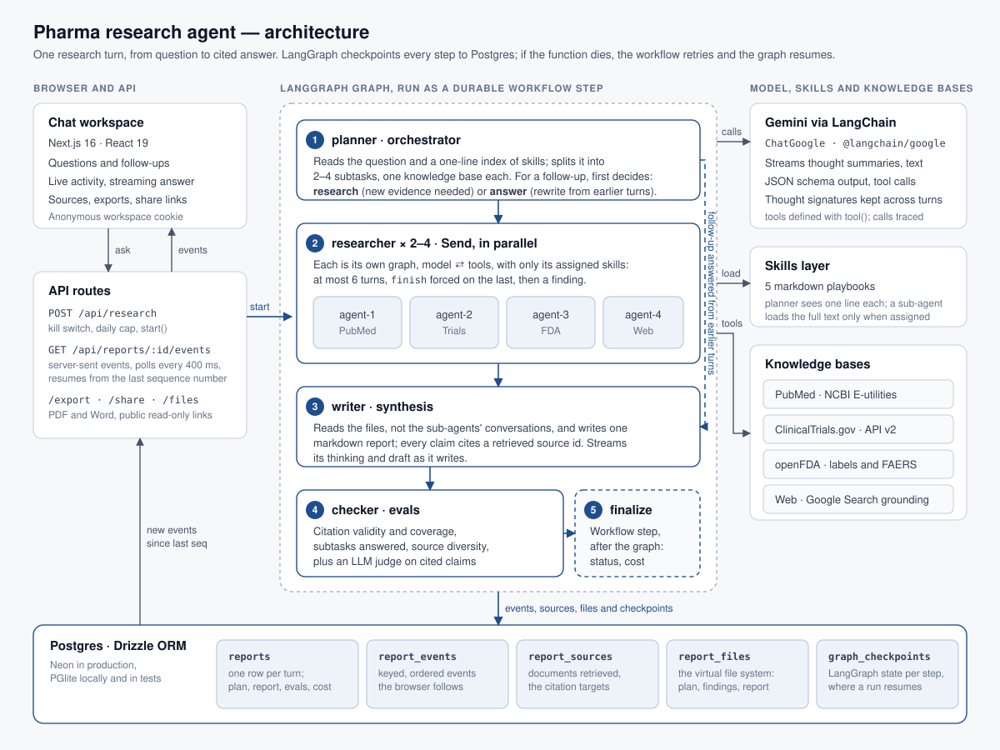

# Architecture

One research turn, from question to cited answer. Paths are relative to `agents/pharma-research-agent/`.

## Request path

1. **Ask.** The chat UI posts the question, and the thread it belongs to, to `POST /api/research` (`app/api/research/route.ts`). The route checks the operator controls (`RESEARCH_ENABLED`, `DAILY_RUN_CAP`), creates a `reports` row and starts the workflow with `start()`. It returns at once; the research runs in the background.
2. **Follow.** The browser opens `GET /api/reports/:id/events`, a server-sent event stream. The route polls `report_events` every 400 ms and sends anything newer than the last sequence number the browser has seen, so a dropped connection resumes where it stopped.
3. **Read.** When the run finishes, the browser reloads the final snapshot. Exports (`/export?format=pdf|docx`), share links (`/share`) and the virtual file system (`/files`) read from the same tables.

## The durable workflow

`workflows/research.ts` orchestrates; `workflows/steps.ts` holds the steps. Each step is retried on failure and writes only keyed rows, so a retry overwrites its own output instead of duplicating it. If the function running a step dies, the run resumes from the last completed step.

| Step | Agent | What it does |
|---|---|---|
| 1. Plan | Orchestrator (`lib/research/agents/orchestrator.ts`) | Splits the question into 2–4 subtasks, one knowledge base each, and assigns skills from a one-line index. For a follow-up it first decides between **research** (new evidence needed) and **answer** (simplify, shorten or explain from the earlier turns). |
| 2. Research | Sub-agents (`agents/researcher.ts`), in parallel | Each runs a bounded tool loop against one knowledge base: at most 6 turns, with `finish` forced on the last. A failed knowledge base becomes an honest empty finding rather than failing the run. |
| 3. Synthesis | Writer (`agents/synthesis.ts`) | Reads the files (`/findings/*`, `/sources/CATALOGUE.md`), not the sub-agents' conversations, and writes one markdown report in which every claim cites a retrieved source id. In answer mode it reads `/context/earlier.md`, the earlier answers with their citations, instead. |
| 4. Evals | Checks and judge (`lib/research/evals.ts`) | Citation validity and coverage, subtasks answered and source diversity, plus a model judge that checks cited sentences against the passages of their sources most relevant to each claim. |
| 5. Finalize | — | Records status, duration, tokens and cost. |

A follow-up in answer mode has no subtasks, so it goes straight from plan to synthesis (the dashed line in the diagram). It reuses the earlier turns' sources, so its citations still resolve.

## Model, skills and knowledge bases

- **Gemini** (`lib/research/gemini.ts`) is called over REST `streamGenerateContent`, with no SDK. It streams thought summaries and text, returns structured output against a JSON schema, makes function calls, and keeps thought signatures across turns of a tool loop. Every call is a span in the trace, with tokens and cost.
- **Skills** (`skills/*.md`) are markdown playbooks. The planner sees one line per skill; a sub-agent's prompt gets a playbook's full text only when that skill is assigned to it (progressive disclosure).
- **Knowledge bases** (`lib/research/sources/`): PubMed through NCBI E-utilities, ClinicalTrials.gov API v2, openFDA drug labels and FAERS counts, and the web through Gemini's Google Search grounding. Each client has a timeout, client-side rate limiting and bounded retries.

## Storage

Postgres through Drizzle ORM (`lib/db/`): Neon over HTTP when `DATABASE_URL` is set, otherwise embedded PGlite in `.data/pglite` (and in memory for tests).

| Table | Holds |
|---|---|
| `reports` | One row per turn, grouped into threads: query, status, plan, report, evals, and token, call and cost totals. |
| `report_events` | Every agent event, keyed (`span:<id>`, `thought:<key>`, `finding:<subtask>`, …) and ordered by a sequence, so the browser can resume and a retried step replaces its own events. |
| `report_sources` | Every document retrieved: the targets citations must point to. |
| `report_files` | The virtual file system: `/plan.md`, `/findings/*`, `/sources/CATALOGUE.md`, `/report.md`, `/evals/*`. |

Agents never wait on the database: `EventSink` (`lib/research/persist.ts`) queues writes in order and is flushed at the end of each step, and a failed write fails the step so it retries.
