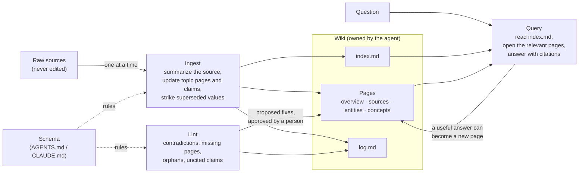

# Wiki memory for agents: let the model keep the notes

Most agents forget everything between sessions, or remember it in the least useful form: a pile of raw chunks they search again for every question. Wiki memory is a different arrangement. The agent **maintains a small wiki of markdown pages**. Each time a new source arrives, it updates the pages about the people, systems and policies that source mentions, links them to each other, records what changed, and marks what the source made out of date. Questions are answered from those pages, which already reflect everything read so far.

Andrej Karpathy described this pattern in April 2026 as the [“LLM Wiki”](https://gist.github.com/karpathy/442a6bf555914893e9891c11519de94f). This article explains how it works, compares it with retrieval (RAG) and with other kinds of agent memory, and walks through a complete example: five short sources about a fictional project, ingested one at a time, with the real wiki pages before and after each step.

**Try it:** this folder contains a small web app that plays the example. You ingest the sources one by one and watch pages being created and rewritten (as diffs), links appearing in the page graph, and the index and log growing. A lint pass then flags two contradictions, and you can ask three questions to see which wiki pages answer each one, next to what plain chunk RAG retrieves. It runs offline, with no API key. See [The demo app](#the-demo-app).

## Key takeaways

1. **Wiki memory moves the work from question time to write time.** RAG finds and reconciles fragments of raw documents on every question. A wiki agent does that once, when each source arrives, and keeps the result as pages anyone can read.
2. **There are three layers and three operations.** Raw sources are never edited; the wiki belongs to the agent; a schema file tells it how to keep the wiki. The operations are *ingest* (fold a new source into the pages), *query* (answer from the pages) and *lint* (check the whole wiki for contradictions, broken links and stale claims).
3. **Superseding is the part RAG can't do.** When a source says “the limit was lowered from 100 to 50”, the agent strikes the old value through on every page that states it. Chunk RAG still holds the March design doc that says 100, and will retrieve it.
4. **Lint is not optional.** An ingest only sees the pages it opens. In our example, a draft FAQ introduces two wrong values that no single ingest could catch; a pass over every claim at once finds both.
5. **It is not a replacement for RAG at scale.** Karpathy reports that an index file works “at moderate scale (~100 sources, ~hundreds of pages)”. Beyond that you need search over the wiki. And every page is model-written, so errors can persist and spread unless people review the changes.

## What wiki memory is, and why it matters

Karpathy's gist starts from how most people use LLMs with documents:

> Most people's experience with LLMs and documents looks like RAG: you upload a collection of files, the LLM retrieves relevant chunks at query time, and generates an answer. This works, but the LLM is rediscovering knowledge from scratch on every question. There's no accumulation.

Instead, the LLM “incrementally builds and maintains a persistent wiki — a structured, interlinked collection of markdown files that sits between you and the raw sources”. When a new source arrives, the model doesn't just index it: it integrates it, “updating entity pages, revising topic summaries, noting where new data contradicts old claims”. In his words, “the wiki is a persistent, compounding artifact”.

The argument for why this works now is about cost, not intelligence: “Humans abandon wikis because the maintenance burden grows faster than the value.” A model can update fifteen cross-references in one pass without getting bored, so the upkeep that kills human wikis becomes cheap.

### How it compares

Agent memory is a crowded space, and the term covers very different things. This table compares wiki memory with the three approaches people usually mean.

| | Chunk RAG | Chat-history memory | Extracted-fact (vector or graph) memory | Wiki memory |
| --- | --- | --- | --- | --- |
| **What is stored** | Raw documents, split into chunks and embedded | The conversation, or rolling summaries of it | Small facts or memories pulled out of conversations, in a vector store or a knowledge graph | Markdown pages about entities and concepts, with links, an index and a log |
| **When the work happens** | At question time | Every turn, by carrying the history | At write time (extraction), plus retrieval at question time | At write time (ingest) and in periodic lint passes |
| **Handles changed facts** | No: old and new chunks are both retrieved | Only while the change is still in the window or summary | Depends on the system; some mark old facts invalid | Yes: the agent strikes old claims through and links the source that replaced them |
| **Readable by people** | The sources are; the index isn't | Partly | Usually through a tool or API | Yes: plain files, diffable in git |
| **Scales to** | Millions of chunks | One context window | Large stores, with search | Hundreds of pages with an index file; more needs search over the wiki |
| **Main risk** | Contradictory or outdated chunks with nothing marking which is current | Lost details after summarizing | Wrong or duplicate extracted facts | Model-written errors that persist; drift as pages are rewritten |
| **Examples** | Most document Q&A tools | Conversation buffers and summaries | [LangMem](https://langchain-ai.github.io/langmem/concepts/conceptual_guide/) collections and profiles; [Zep](https://arxiv.org/abs/2501.13956), a temporal knowledge graph | Karpathy's LLM Wiki; Claude Code's auto memory directory (below) |

The ideas overlap. [MemGPT](https://arxiv.org/abs/2310.08560) (Packer et al., 2023) framed memory as an operating-system problem, with the model moving information between its context window and slower storage. Its successor, Letta, gives agents editable [memory blocks](https://docs.letta.com/guides/agents/memory-blocks) and [sleep-time agents](https://letta.com/blog/sleep-time-compute) that reorganize memory between conversations, which is close to a lint pass. LangMem distinguishes semantic memory (“the essential facts and other information that ground an agent's responses”) from episodic and procedural memory, and stores semantic memory either as a *collection* of separate records or as a *profile*, a single document that “updates the existing document rather than creating a new one”. A wiki page is a profile per topic, with links between them. [A-MEM](https://arxiv.org/abs/2502.12110) (Xu et al., NeurIPS 2025) builds linked notes in the style of a Zettelkasten, where a new memory can update the description of older ones.

Coding agents already use a small version of this. Anthropic's [memory tool](https://platform.claude.com/docs/en/agents-and-tools/tool-use/memory-tool) gives Claude a `/memories` directory it can view, create, edit, rename and delete files in, and the API tells it to check that directory before starting a task. [Claude Code's auto memory](https://code.claude.com/docs/en/memory) keeps a `MEMORY.md` index with “one line per memory” and one topic file per memory. Only the first 200 lines or 25KB of the index load at the start of a session; topic files are read on demand. That is the index-plus-pages structure of a wiki, applied to an agent's own working notes rather than to a body of sources.

## How it works

### Three layers

Karpathy's gist describes three layers:

- **Raw sources**: “your curated collection of source documents … These are immutable — the LLM reads from them but never modifies them. This is your source of truth.”
- **The wiki**: “a directory of LLM-generated markdown files. Summaries, entity pages, concept pages, comparisons, an overview, a synthesis. The LLM owns this layer entirely.”
- **The schema**: a document such as `CLAUDE.md` or `AGENTS.md` “that tells the LLM how the wiki is structured, what the conventions are, and what workflows to follow”. It is what makes the model a disciplined maintainer rather than a chatbot, and you refine it as you learn what works.

Our example's schema is [`corpus/schema.md`](corpus/schema.md). It defines four page types (overview, source, entity, concept), the front matter every page carries, and one rule the gist leaves open: how to record a fact that can change. We call those **claims** (more on them below).

### Two special files

- **`index.md`** lists every page with a link and a one-line summary, grouped by type. The agent updates it on every ingest and reads it first when answering a question, then opens the pages it needs. The gist says this “works surprisingly well at moderate scale (~100 sources, ~hundreds of pages) and avoids the need for embedding-based RAG infrastructure”.
- **`log.md`** is an append-only record of ingests, queries and lint passes. Starting each entry with a fixed prefix such as `## [2026-04-02] ingest | Article Title` lets ordinary tools read it: `grep "^## \[" log.md | tail -5` shows the last five entries.

### Three operations



- **Ingest.** The agent reads the source, writes a summary page for it, updates the index, updates every entity and concept page the source is about, and appends to the log. The gist notes that “a single source might touch 10-15 wiki pages”, and that Karpathy prefers to ingest one source at a time and check the changes.
- **Query.** The agent reads the index, opens the relevant pages and answers with citations. The gist adds that “good answers can be filed back into the wiki as new pages”, so a comparison you asked for doesn't vanish into chat history.
- **Lint.** Periodically, the agent checks the whole wiki for “contradictions between pages, stale claims that newer sources have superseded, orphan pages with no inbound links, important concepts mentioned but lacking their own page, missing cross-references, data gaps”.

### Claims: making facts checkable

The gist leaves page formats to you. We added one convention that makes the most important lint check exact. Any fact that can change goes in a `## Claims` section, one per line, with a key, a value, the date it applies from and the source:

```text
## Claims
- ~~`billing-api.rate-limit`: 100 requests per second per client (as of 2026-03-16, [[src-design-doc]])~~ superseded by [[src-inc-482]]
- `billing-api.rate-limit`: 50 requests per second per client (as of 2026-04-03, [[src-inc-482]])
```

The schema has two rules for new values:

- If a source **says** it replaces the old value (“lowered from 100 to 50”), strike the old claim through and add the new one. The history stays visible.
- If a source states a different value **without** saying it replaces anything, add it next to the old one and don't choose. Lint flags the pair for a person to decide.

Code can then compare every current claim in the wiki: two claims conflict when their keys match, or one is the parent of the other (`export.retention` and `export.retention.standard`), and their values differ. Contradictions written only in prose still need a model to find them.

## A worked example: Ledger Export

The corpus is five short, original documents about a fictional team building **Ledger Export**, a feature that lets customers download their invoices as a CSV file. The names, company and numbers are invented. The documents are in [`corpus/raw/`](corpus/raw/):

| Date | Source | What it adds |
| --- | --- | --- |
| 2 Mar 2026 | Kickoff notes | The project, its owner, a nightly job, files kept 30 days |
| 16 Mar 2026 | Pipeline design doc | Runs at 02:00 UTC; the Billing API allows 100 requests per second, the job will use 80; links expire after 7 days |
| 7 Apr 2026 | Incident report INC-482 | The Billing API limit was **lowered from 100 to 50**; the job now uses 40 |
| 20 Apr 2026 | Support chat thread | From 1 May, Enterprise exports are kept **90 days**; other plans stay at 30 |
| 5 May 2026 | Draft help-centre FAQ | Says exports run **every hour** and are kept **7 days**. Both are wrong |

The pages the agent writes at each step are in [`corpus/steps/`](corpus/steps/). We wrote them by hand to show what a careful model should produce, following the schema exactly; no model was called (see [Reproducibility](#reproducibility)). Everything else, including the diffs, index, log, graph, lint findings and retrieval results below, is computed from those pages by code in [`src/`](src/). The final wiki, with its index and log, is in [`results/wiki/`](results/wiki/).

### Ingest 1: the kickoff creates the wiki

The first source creates seven pages: a summary of the source, pages for the project, its two owners and the Billing API, a concept page for the retention policy, and an overview. Here is the project page as created:

```markdown
---
type: entity
summary: The self-serve invoice CSV export project.
sources: [src-kickoff]
updated: 2026-03-02
---
# Ledger Export

A customer picks a date range and receives one CSV of their invoices. It replaces manual exports by support, about 40 tickets a week ([[src-kickoff]]).

- Owner: [[amara-osei]]. Customer-facing copy: [[rui-costa]].
- Runs as a nightly batch job on the Postgres read replica.
- Reads invoice totals from the [[billing-api]].
- How long files are kept: [[export-retention]].

## Claims
- `export.schedule`: nightly (as of 2026-03-02, [[src-kickoff]])
```

The Billing API page ends with an open question from the meeting: *What request rate may Ledger Export use?*

### Ingest 2: the design doc mostly updates

Two pages are new (the source summary and the Payments team); five are edited. The design doc answers the kickoff's open question, so the agent removes it from the Billing API page and adds the claim in its place:

```diff
-Owned by the Payments team. [[ledger-export]] reads each invoice's final total from it ([[src-kickoff]]).
+Owned by the [[payments-team]]. [[ledger-export]] reads each invoice's final total from it ([[src-kickoff]]). [[jun-park]] confirmed the limit ([[src-design-doc]]).

-## Open questions
-- What request rate may Ledger Export use? Raised at the kickoff.
+## Claims
+- `billing-api.rate-limit`: 100 requests per second per client (as of 2026-03-16, [[src-design-doc]])
```

Note the link to `[[jun-park]]`: there is no page for Jun yet. Nothing complains now; lint will.

### Ingest 3: the incident report supersedes two values

This is the step that RAG has no equivalent for. The incident report says the limit was cut from 100 to 50 and the job now sends 40. The agent rewrites the claims on two pages, keeping the old values as struck-through history. On the project page:

```diff
-- Reads invoice totals from the [[billing-api]].
+- Reads invoice totals from the [[billing-api]], backing off on HTTP 429 ([[src-inc-482]]).
-- Risk: a slow Billing API could push the run past 06:00 UTC ([[src-design-doc]]).
+- Alerts if the run hasn't finished by 06:00 UTC ([[src-inc-482]]).
+- Past incidents: [[inc-482]].
 ...
-- `export.billing-api-rate`: 80 requests per second (as of 2026-03-16, [[src-design-doc]])
+- ~~`export.billing-api-rate`: 80 requests per second (as of 2026-03-16, [[src-design-doc]])~~ superseded by [[src-inc-482]]
+- `export.billing-api-rate`: 40 requests per second (as of 2026-04-07, [[src-inc-482]])
```

It also creates a page for the incident and a concept page, `api-rate-limits`, for the general lesson (leave headroom, back off on HTTP 429, alert on the outcome). One source touched eight pages, and the graph went from 21 to 37 links.

### Ingest 4: a decision made in chat

A four-message thread changes the retention policy. The agent replaces the single 30-day claim with one claim per plan, and says so in prose as well:

```diff
-summary: How long finished export files are kept before deletion.
+summary: How long finished export files are kept: 90 days on Enterprise, 30 on other plans.
 ...
+From 1 May 2026 the period depends on the plan: Enterprise files are kept for 90 days and files on all other plans for 30 days. The rule reads a plan tag, so files written before then keep their old date ([[src-support-thread]]).
 ...
-- `export.retention`: 30 days (as of 2026-03-16, [[src-design-doc]])
+- ~~`export.retention`: 30 days (as of 2026-03-16, [[src-design-doc]])~~ superseded by [[src-support-thread]]
+- `export.retention.standard`: 30 days (as of 2026-05-01, [[src-support-thread]])
+- `export.retention.enterprise`: 90 days (as of 2026-05-01, [[src-support-thread]])
```

### Ingest 5: a draft that disagrees

The draft FAQ says exports run every hour and are kept for 7 days. It doesn't claim to change anything, so the schema says: record it, don't choose. The agent adds one line to the retention page and one to the project page:

```diff
 - `export.link-expiry`: 7 days (as of 2026-03-16, [[src-design-doc]])
+- `export.retention`: 7 days (as of 2026-05-05, [[src-faq-draft]])
```

After five ingests the log reads:

```markdown
## [2026-03-02] ingest | Kickoff notes
- source: raw/2026-03-02-kickoff-notes.md
- created: [[amara-osei]], [[billing-api]], [[export-retention]], [[ledger-export]], [[overview]], [[rui-costa]], [[src-kickoff]]

## [2026-03-16] ingest | Pipeline design doc
- source: raw/2026-03-16-design-doc.md
- created: [[payments-team]], [[src-design-doc]]
- updated: [[amara-osei]], [[billing-api]], [[export-retention]], [[ledger-export]], [[overview]]

## [2026-04-07] ingest | Incident report INC-482
- source: raw/2026-04-07-incident-inc-482.md
- created: [[api-rate-limits]], [[inc-482]], [[src-inc-482]]
- updated: [[amara-osei]], [[billing-api]], [[ledger-export]], [[overview]], [[payments-team]]
...
```

| After ingest | Pages | Links | Current claims | Struck through | Pages touched | Lines added / removed |
| --- | --- | --- | --- | --- | --- | --- |
| 1 Kickoff | 7 | 12 | 2 | 0 | 7 | +95 / −0 |
| 2 Design doc | 9 | 21 | 5 | 0 | 7 | +51 / −21 |
| 3 Incident | 12 | 37 | 5 | 2 | 8 | +70 / −17 |
| 4 Chat thread | 13 | 43 | 6 | 3 | 5 | +35 / −12 |
| 5 FAQ draft | 14 | 47 | 8 | 3 | 5 | +28 / −10 |

### Lint: what no single ingest could see

[`src/lint.ts`](src/lint.ts) runs four checks over the whole wiki. After the fifth ingest it reports:

| Check | Found |
| --- | --- |
| Contradicting claims | 2: `export.retention` is 30 days (standard), 90 days (Enterprise) and 7 days (FAQ draft); `export.schedule` is “nightly at 02:00 UTC” (design doc) and “every hour” (FAQ draft) |
| Links to missing pages | 1: `[[jun-park]]`, linked from four pages |
| Pages nothing links to | 0 |
| Claims citing a missing source | 0 |

Note what the lint does *not* do: pick the newest value. The newest claim here is the FAQ draft's, and it is wrong. Lint proposes fixes and a person approves them. Our scripted fix strikes the draft's two claims through as `disputed`, notes on the FAQ's source page what needs correcting (“7 days is the download link's expiry”), creates Jun Park's page and updates the overview's open questions. Run again, lint finds nothing.

### Query: wiki pages compared with chunk RAG

To compare the two fairly, both sides use the same BM25 ranker ([`src/retrieve.ts`](src/retrieve.ts)). Chunk RAG ranks the 25 paragraph chunks of the raw sources (each with its document title) and keeps the top 3. The wiki side ranks the 10 topic pages (entities, concepts and the overview) and keeps the top 2, as a stand-in for an agent reading `index.md` and opening the relevant pages. For each question we listed the facts a correct answer needs and the specific sentences that would mislead, and checked which of them each side retrieved. Struck-through claims are shown but not counted as current.

| Question | Wiki: needed facts | Wiki: misleading statements | Chunk RAG: needed facts | Chunk RAG: misleading statements |
| --- | --- | --- | --- | --- |
| How long are customer exports kept? | 2 of 2 | 0 | 2 of 2 | 2: the FAQ draft's “kept for 7 days”, the kickoff's “kept for 30 days, then deleted” |
| What request rate does the export job use against the Billing API? | 2 of 2 | 0 | 2 of 2 | 2: the design doc's “allows 100 requests per second” and “will call it at 80” |
| Why did the nightly exports fail in April? | 2 of 2 | 0 | 2 of 2 | 0 |

Chunk RAG did find the right answer every time. The problem is what came with it: for the two questions whose answer changed over time, the top chunks also contained the old values, and nothing in the chunks says which one is current. The model answering has to work that out from dates and wording, on every question. The wiki pages had already done it. For the third question, whose whole answer sits in one source that nothing contradicts, chunk RAG did as well as the wiki. That is the honest summary of the trade-off.

This is one small example, not a benchmark. With an embedding retriever, a different chunk size or a larger corpus the rankings would differ.

## Trade-offs and failure modes

- **Errors persist.** In RAG, a bad answer disappears with the conversation. In a wiki, a wrong sentence the model writes into a page is read back on every later question and copied into other pages. Review ingests the way you review code: the wiki is a folder of markdown, so keep it in git and read the diffs.
- **Drift.** Each ingest rewrites pages. Over many rewrites, nuance gets lost and a summary can stop matching its sources. Keep raw sources immutable, cite a source after every fact, and spot-check pages against their sources.
- **Contradictions are easy to miss.** An ingest only sees the pages it opens; in our example, ingest 5 recorded two wrong values without noticing they were wrong. Run lint regularly, and make facts that can change machine-checkable (our claims) so at least those contradictions are caught exactly.
- **Recency is not truth.** “Keep the newest value” would have kept the draft FAQ's 7 days. Superseding should need the source to say it supersedes; otherwise, flag it for a person.
- **Scale.** An index file works up to roughly hundreds of pages, by Karpathy's account. After that you need search over the wiki itself; the gist suggests [qmd](https://github.com/tobi/qmd), a local search engine for markdown with BM25, vector search and reranking. At that point you have RAG over the wiki, which is fine: you are retrieving reconciled pages instead of raw fragments.
- **Cost moves to write time.** Each ingest reads the source, the index and every page it updates, then writes several pages. In our run one source touched 5 to 8 pages. The wiki also grows: its final 15 pages hold about 10,900 characters, nearly three times the 3,800 characters of the five sources, because of front matter, links, summaries and history. You pay for that once per source rather than once per question, which favors wikis that are read much more often than they are written.
- **Provenance and permissions.** A page that merges five sources is harder to permission than five documents. If different users may see different sources, a shared wiki can leak across that boundary; keep separate wikis or keep restricted sources out.
- **Concurrency.** Two agents ingesting at once can overwrite each other's edits to the same page. Serialize ingests, or use git branches and merge.

### When to prefer RAG

- The corpus is large and mostly static, and questions are answered from one passage at a time.
- Sources change often and come from systems of record that are already correct (use them directly, rather than a copy that can go stale).
- You need exact quotations or legal-grade provenance on every answer.
- Nobody will review what the model writes.

Wiki memory fits best where knowledge accumulates and changes: a research topic over weeks, an internal project with decisions scattered across meetings and chat, an agent's own notes about a codebase or a user.

## Practical advice

1. **Write the schema first.** Page types, front matter, how to cite, how to record facts that change, what lint checks. Put it in your agent's instruction file. Expect to revise it after the first ten ingests.
2. **Ingest one source at a time at first, and read the diff.** This is when you find out whether the model files things where you would look for them.
3. **Keep raw sources immutable and cite them after every fact.** Every claim should lead back to a source that a person can read.
4. **Supersede explicitly; never delete history.** Strike old values through with the source that replaced them. Your log and git history then show when and why a fact changed.
5. **Make changeable facts structured.** A `## Claims` section (or YAML front matter) turns the most important contradiction check into code.
6. **Lint on a schedule, and have a person approve fixes that choose between sources.**
7. **File good answers back.** If a question took real synthesis, save the answer as a page and link it.
8. **Add search when the index stops fitting in context**, and search the wiki, not just the raw sources.

## The demo app

The app plays the worked example as a short film in three acts, dark by default, with a subtitle line that says in plain words what each moment shows.

- **Opening shot.** Five documents drift in and dissolve into the finished web of fifteen linked pages. **Watch the wiki grow** starts the story; **Skip to the face-off** jumps to act three.
- **Act one: ingest.** Each source is a scene. Its card flies out of the queue into the web, the pages it creates ignite, the pages it rewrites pulse, and new links draw themselves as light trails while the camera moves in. Beside the web, the agent's edit to the most instructive page types itself in, and replaced values are struck through in red. The other pages it touched, and `index.md` and `log.md` with this step's new lines typed in, are one click away.
- **Act two: lint.** A scan passes over the whole web, then the pages and sources that disagree pulse red and dashed arcs join the conflicting sources. The panel shows the conflicting values side by side. In the fix scene the red settles, Jun Park's page ignites, and lint reports 0 problems.
- **Act three: the face-off.** For each question, the top wiki pages and the top raw chunks are revealed side by side, then the facts each contains, then the scores, and the computed verdict lands last.

Scenes autoplay once you reach them. Pause, step and replay with the transport buttons, the scene chips, the source cards, or <kbd>←</kbd>, <kbd>→</kbd> and <kbd>Space</kbd>. Each beat lasts under 1.5 seconds and controls respond at once. With reduced motion set in the operating system, every scene appears in its final state with nothing moving. The web is drawn on a canvas with no libraries, and only the visible section animates.

Every view can be linked, and any moment can be frozen for review:

- `?scene=3` opens a scene. Scenes 1 to 5 are the ingests, 6 is lint and 7 is the fix.
- `?ask=rate` opens a face-off question (`retention`, `rate` or `incident`).
- `&t=1900` freezes the clock at that many milliseconds into the scene, or into the opening shot when no scene is given.
- `&file=@log` (or `@index`, or a page such as `billing-api`) opens that file in the panel.
- `&solo=1` shows only that section, which helps headless screenshots.
- `&theme=light` or `&theme=dark` forces a theme.

### Run it

Requires Node.js 22.12 or later. No API keys and no network calls apart from Google Fonts. From `agents/wiki-memory/`:

```bash
npm ci
npm start          # builds and serves http://127.0.0.1:4331 (PORT and HOST to change)
npm test           # parsing, diffs, lint, retrieval, layout, and the recorded run
npm run check      # TypeScript type check
npm run data       # rebuilds results/run.json and results/wiki/ from corpus/
npm run export     # static copy of the app in dist/
```

You should see the opening shot assemble itself, with a **Watch the wiki grow** button. `npm test` should report 14 passing tests; one of them fails if `results/run.json` is out of date with `corpus/` or `src/`, so run `npm run data` after editing either.

### How it is built

- [`corpus/raw/`](corpus/raw/): the five sources. [`corpus/schema.md`](corpus/schema.md): the wiki's rules. [`corpus/steps/`](corpus/steps/): for each step, the full text of every page the agent writes, plus a `step.json` with the step's notes.
- [`src/wiki.ts`](src/wiki.ts): parses pages (front matter, links, claims) and builds the index, log and link graph. [`src/diff.ts`](src/diff.ts): a line diff. [`src/lint.ts`](src/lint.ts): the four checks. [`src/retrieve.ts`](src/retrieve.ts): chunking, BM25 and the fact checks. [`src/questions.ts`](src/questions.ts): the three questions. [`src/layout.ts`](src/layout.ts): a deterministic graph layout. [`src/build.ts`](src/build.ts): plays the steps and writes the run.
- [`client/web.ts`](client/web.ts): the canvas renderer for the web of pages (ignition, light-trail links, lint pulses, camera, parallax), where every frame is a function of the scene clock. [`client/app.ts`](client/app.ts): the hero, the scenes, the subtitles and the face-off. [`client/styles.css`](client/styles.css): Tailwind CSS v4 and the sequenced animations. [`site/index.html`](site/index.html): the page.
- [`results/run.json`](results/run.json): the recorded run the app reads. [`results/wiki/`](results/wiki/): the final wiki as files you can open in any markdown editor.

To try your own corpus, replace the files in `corpus/raw/` and `corpus/steps/`, edit `src/questions.ts`, and run `npm run data`.

## Limitations

- **The agent is scripted.** We wrote the pages by hand to show the pattern working as intended. A real model will make mistakes this example doesn't show: missing a page it should update, merging two entities, or paraphrasing a number wrongly. Treat the example as a description of the target behavior, not evidence that models achieve it.
- **The retrieval comparison is small and lexical.** Five sources, 25 chunks, three questions, BM25 only. The wiki side ranks pages with the same BM25 scorer instead of letting a model read the index. The fact checks match specific sentences we chose. These results illustrate the mechanism; they don't measure answer quality.
- **Lint only checks structured claims exactly.** Contradictions written in prose need a model, which can miss them or invent them.
- **No live mode.** The app makes no model calls. Adding one would mean prompting a model with the schema, the source, `index.md` and the pages it asks to open, then validating its output with the same parser and lint used here.

## Reproducibility

- Everything in `results/` is deterministic: `npm run data` rebuilds it from `corpus/` with no network or model calls, and the test suite checks the committed copy is current.
- What is **scripted**: the five sources, every wiki page in `corpus/steps/`, the step verdicts and lessons, and the three example answers in `src/questions.ts`.
- What is **computed**: the diffs, `index.md`, `log.md`, the link graph and its layout, the lint findings, the chunking, the BM25 rankings and the fact checks.
- Verified with Node.js 26.6 on macOS, on 2026-10-21: `npm ci`, `npm test` (14 passing), `npm run check`, `npm start` and `npm run export`.
- The corpus is original and synthetic, written for this example; any resemblance to a real company or person is unintended.

## Sources

- Andrej Karpathy, [LLM Wiki](https://gist.github.com/karpathy/442a6bf555914893e9891c11519de94f), GitHub gist, 4 April 2026. All quotations in this article are from this gist unless marked otherwise.
- Anthropic, [Memory tool](https://platform.claude.com/docs/en/agents-and-tools/tool-use/memory-tool), Claude API documentation.
- Anthropic, [How Claude remembers your project](https://code.claude.com/docs/en/memory), Claude Code documentation: `CLAUDE.md` files and auto memory.
- Anthropic, [Effective context engineering for AI agents](https://www.anthropic.com/engineering/effective-context-engineering-for-ai-agents), 29 September 2025: structured note-taking as agentic memory.
- Charles Packer et al., [MemGPT: Towards LLMs as Operating Systems](https://arxiv.org/abs/2310.08560), arXiv:2310.08560, 2023.
- Letta, [Memory blocks](https://docs.letta.com/guides/agents/memory-blocks) documentation, and [Sleep-time Compute](https://letta.com/blog/sleep-time-compute), 21 April 2025.
- Preston Rasmussen et al., [Zep: A Temporal Knowledge Graph Architecture for Agent Memory](https://arxiv.org/abs/2501.13956), arXiv:2501.13956, 2025.
- LangChain, [LangMem core concepts](https://langchain-ai.github.io/langmem/concepts/conceptual_guide/): semantic, episodic and procedural memory; collections and profiles.
- Wujiang Xu et al., [A-MEM: Agentic Memory for LLM Agents](https://arxiv.org/abs/2502.12110), arXiv:2502.12110, NeurIPS 2025.
- [qmd](https://github.com/tobi/qmd), a local search engine for markdown files, mentioned in the gist.

Related in this repository: [Anatomy of a harness](../harness-anatomy/README.md) (memory and context management as parts of an agent harness) · [Chunking strategies](../../rag-retrieval/chunking-strategies/README.md) · [Agents & Workflows community category](https://aiengineer.help/c/agents-workflows/7)
