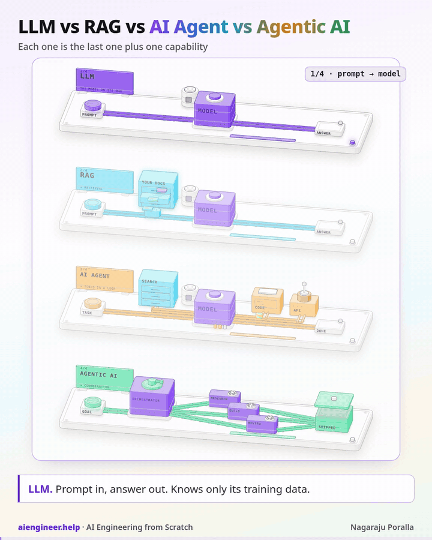
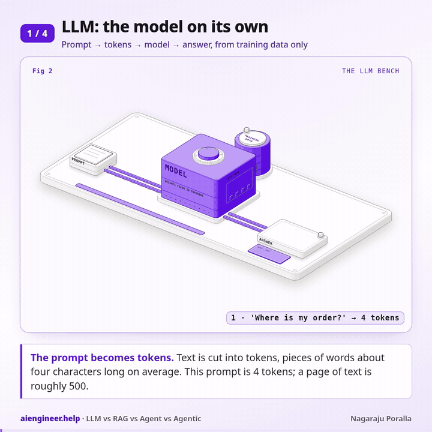
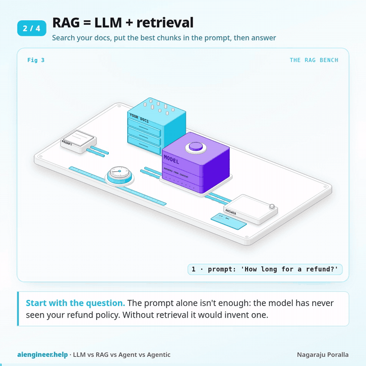
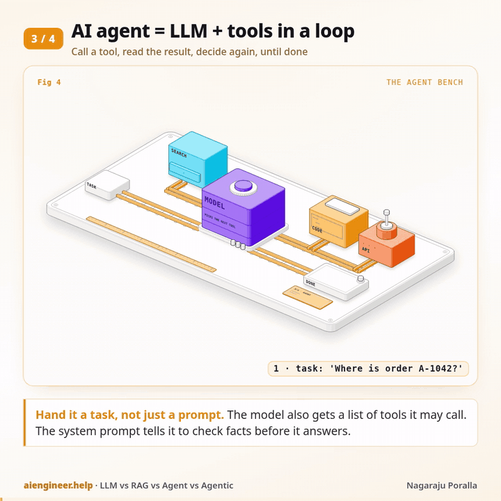
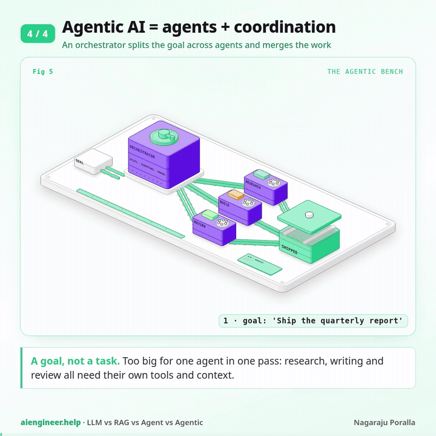

# LLM vs RAG vs AI agent vs agentic AI: each one is the last one plus one capability

*By Nagaraju Poralla ([@Porallanagaraju13](https://github.com/Porallanagaraju13)) · October 14, 2026*

[Category: Careers & Learning](../README.md) · [Community category](https://aiengineer.help/c/careers-learning/10)

People use these four terms as if they were rival products. They aren't. They're layers. RAG is an LLM with retrieval added. An agent is an LLM with tools it can call in a loop. Agentic AI is several agents with something coordinating them. Each step up adds one capability, and each one also adds latency, cost and a new way to fail.

That gives you a simple rule: pick the lowest level that does the job, and only move up when you can name the specific failure the next level fixes.

The overview below shows all four as benches on a shelf. The violet block is the model, and it's the same on every bench. Each bench adds one coloured module. Each level also has its own larger figure further down.




## 1. LLM: prompt in, answer out

A large language model on its own takes text and predicts a continuation, one token at a time. Everything it "knows" came from its training data, which stops at a cutoff date. It has never seen your company wiki, yesterday's prices or the ticket a customer opened ten minutes ago. It can't look anything up, and it can't do anything except write text.




That's still a lot. A plain LLM call is enough for:

- Drafting, rewriting and translating text.
- Summarising or extracting fields from a document you paste into the prompt.
- Classifying support tickets, reviews or emails.
- Explaining code or concepts that were well covered on the public web.

It fails when the answer depends on facts it was never trained on. Ask it about your refund policy and it won't say "I don't know". It will often write a plausible policy that happens to be wrong. That failure, confident answers about data it can't see, is what the next level fixes.

**Use a plain LLM when** everything the model needs is either general knowledge or already in the prompt.

## 2. RAG = LLM + retrieval

Retrieval-augmented generation adds one step before the model runs: your code searches your own documents for the passages most related to the question, and puts the best few into the prompt. The model then answers from that context instead of from memory.




You split documents into chunks of a few hundred tokens, embed each chunk, store the vectors in a vector database, and at question time embed the question and fetch the nearest chunks. On the bench, that's the cyan cabinet: the drawer opens, three chunk cards ride along with the prompt, and only then does the model start.

In code it's a search followed by an ordinary call:

```python
def answer(question: str) -> str:
    hits = collection.query(query_texts=[question], n_results=2)   # retrieval: nearest chunks
    context = "\n".join(hits["documents"][0])
    messages = [{"role": "system", "content": "Answer only from the context. If it isn't there, say you don't know."},
                {"role": "user", "content": f"Context:\n{context}\n\nQuestion: {question}"}]
    return client.chat.completions.create(model="gpt-5-mini", messages=messages).choices[0].message.content
```

With three help-centre snippets in a Chroma collection, the question "How long do I have to ask for my money back?" pulled the two refund chunks and left the password one out, even though the question never uses the word "refund". That's the point of embedding search: it matches meaning, not keywords.

Why not fine-tune the model on your documents instead? Because documents change. With RAG, updating the answer means updating a row in a database. It also lets you show the sources the answer came from, which is what makes people trust it.

The new way to fail is retrieval itself. If the right chunk isn't in the top few, the model either says it doesn't know or answers from the wrong passage. Most "RAG quality" problems are search problems: bad chunking, missing metadata filters, or a question phrased very differently from the documents.

**Use RAG when** answers must come from your own data, that data changes, and one search per question is enough to find what's needed.

## 3. AI agent = LLM + tools in a loop

RAG always does the same thing: search once, then answer. An agent lets the model decide what to do. You describe a set of tools (search, run code, call an API) and the model can reply with "call this tool with these arguments" instead of a final answer. Your code runs the tool, sends the result back, and asks again. The loop ends when the model answers without asking for a tool, or when you hit a step limit.




On the amber bench, the token goes out to the search cabinet, then the code terminal, then the API tower, coming back to the model each time. The three LEDs count the passes. Notice that retrieval didn't disappear: it became one tool among several, used only when the model decides it needs it.

Here's the whole loop with the OpenAI Python SDK and one tool:

```python
def run_agent(task: str, max_steps: int = 6) -> str:
    messages = [{"role": "system", "content": "You are a support agent. Check facts with tools before you answer."},
                {"role": "user", "content": task}]
    for _ in range(max_steps):
        reply = client.chat.completions.create(model="gpt-5-mini", messages=messages, tools=TOOLS).choices[0].message
        if not reply.tool_calls:      # no tool requested: the model thinks it's done
            return reply.content
        messages.append(reply)        # keep the model's tool request in the history
        for call in reply.tool_calls:
            args = json.loads(call.function.arguments)
            result = RUN[call.function.name](**args)
            messages.append({"role": "tool", "tool_call_id": call.id, "content": json.dumps(result)})
    return "Stopped: hit the step limit."
```

`TOOLS` is a JSON schema per tool (name, description, parameters) and `RUN` maps each name to a Python function. That's an agent. Frameworks add tracing, memory and retries around it, but the loop is the same.

What you pay for: every pass through the loop is another model call, and the history grows each time, so cost and latency climb with the number of steps. [Anthropic reported](https://www.anthropic.com/engineering/multi-agent-research-system) that their agents typically use about 4× more tokens than a chat interaction. The new ways to fail are loops that never finish, the wrong tool or wrong arguments, and actions you can't undo. Practical guards:

- A hard step limit and a timeout per run.
- Start with read-only tools. Ask a human to approve anything that writes, pays or sends.
- Validate tool arguments in code, the same way you'd validate user input.
- Log every tool call and its result, so you can see why a run went wrong.

**Use an agent when** the steps can't be scripted in advance: the next action depends on what the last one returned. If you can write the steps as a fixed sequence, write them as normal code with one or two LLM calls inside. It's cheaper, faster and easier to test.

## 4. Agentic AI = agents + coordination

"Agentic AI" gets used loosely. Here it means the next layer: several agents working toward one goal, with an orchestrator that splits the goal into parts, hands each part to an agent with its own instructions, tools and context, and merges what comes back.




On the green bench, the orchestrator's arm swings to dispatch tickets to a research agent, a build agent and a review agent. Each one runs its own tool loop (the chasing lamps), and their results go into the crate marked shipped.

This helps in two situations. The first is when the work splits into independent parts that can run in parallel, such as researching ten companies at once. The second is when one agent's context window would overflow: each sub-agent reads its own pile of material and returns a short summary, so the orchestrator never has to hold everything. A separate review agent that didn't write the work is also better at spotting problems in it.

The cost is real. In the same Anthropic write-up, their multi-agent research system used about 15× more tokens than chat, and they noted it suits high-value, parallel tasks better than tightly connected work like most coding. There are also more places to fail: agents duplicate each other's work, pass along each other's mistakes, or disagree, and the orchestrator has to notice.

**Use agentic AI when** a single agent with good tools has clearly hit its limits, and the task is valuable enough to pay several times more per run.

## Which one should you use?

| Level | Adds | Use it when | Main new risk | Relative cost |
|---|---|---|---|---|
| LLM | nothing: the model alone | General knowledge, or everything needed is in the prompt | Confident answers about facts it can't see | 1 call |
| RAG | Retrieval from your data | Answers must come from your own, changing documents | The search misses the right chunk | 1 search + 1 call |
| AI agent | Tools in a loop | Next step depends on the last result | Loops, wrong tools, irreversible actions | Several calls (Anthropic: ~4× chat) |
| Agentic AI | Coordination of several agents | Parallel or very large, high-value work | Duplication, compounding errors, cost | Many calls (Anthropic: ~15× chat) |

A useful test before you move up a level: write down a real request that fails at the current level, and say which missing capability caused it. "It didn't know our refund window" is a retrieval problem, so add RAG. "It needed the order status, then the carrier's tracking page" is a tools problem, so build an agent. "Researching 30 suppliers in one context ran out of room" is a coordination problem. If you can't write that sentence, stay where you are.

## Run the code

The snippets above live in [`code/`](code/). They need Python 3.11+.

```bash
cd careers-learning/llm-rag-agent-agentic/code
python -m venv .venv && . .venv/bin/activate
pip install -r requirements.txt
python test_rag.py    # RAG: mocked model, real Chroma retrieval; no API key or charges
python test_mock.py   # agent loop: mocked model asks for get_order, then answers
```

Both tests replace the OpenAI HTTP transport with a mock, so they make no paid calls. Chroma downloads a small default embedding model (about 80 MB) on first run. To call a real model, set `OPENAI_API_KEY` and import `rag.answer` or `agent_loop.run_agent` directly; each call is charged by OpenAI. The model name `gpt-5-mini` in the snippets is configurable in the source.

## Files

| Path | What |
| --- | --- |
| `docs/figure.gif` | Overview: the four benches |
| `docs/fig-llm.gif`, `fig-rag.gif`, `fig-agent.gif`, `fig-agentic.gif` | One animated figure per level |
| `code/rag.py`, `code/agent_loop.py` | The RAG and agent-loop snippets |
| `code/test_rag.py`, `code/test_mock.py` | Offline checks with a mocked model |

## Limitations

This is an explainer, not a benchmark. The cost multipliers (about 4× and 15× chat tokens) are quoted from [Anthropic's multi-agent research write-up](https://www.anthropic.com/engineering/multi-agent-research-system), not measured here. The figures are illustrations.

## Sources and credit

Written and illustrated by Nagaraju Poralla. Cost figures: Anthropic, *How we built our multi-agent research system*.

## License

MIT. See [LICENSE](LICENSE). Copyright (c) 2026 Nagaraju Poralla.
