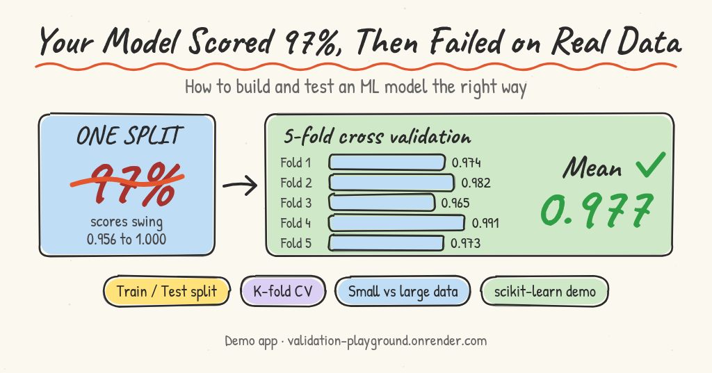
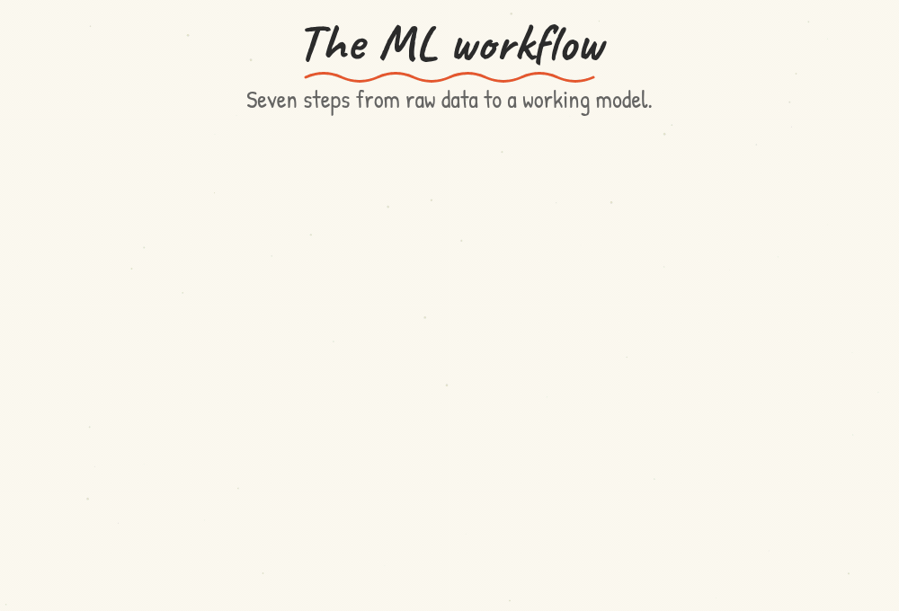
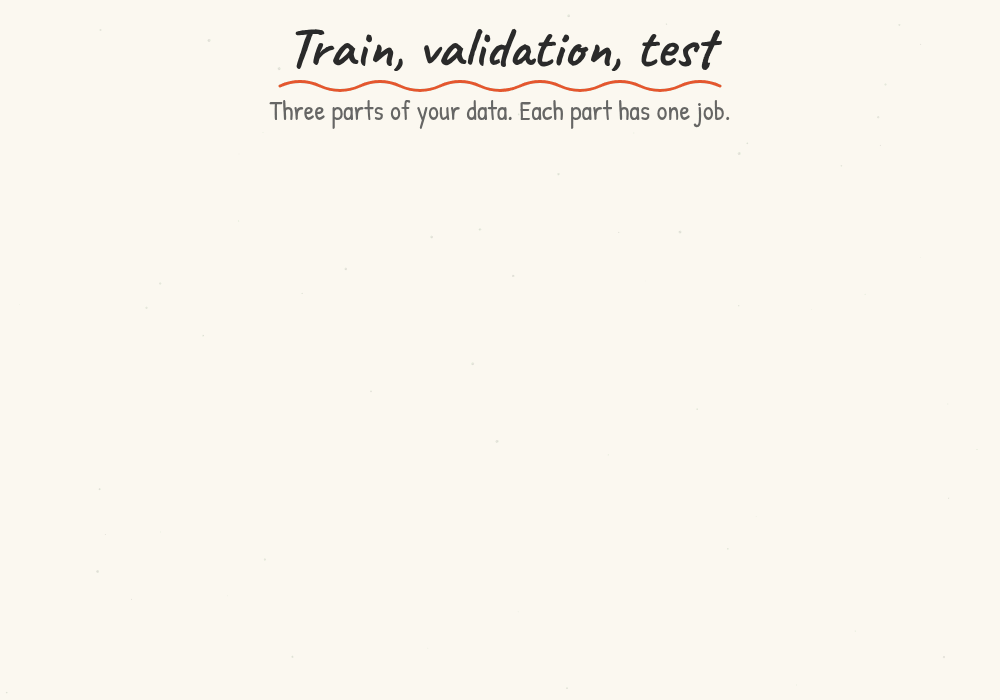
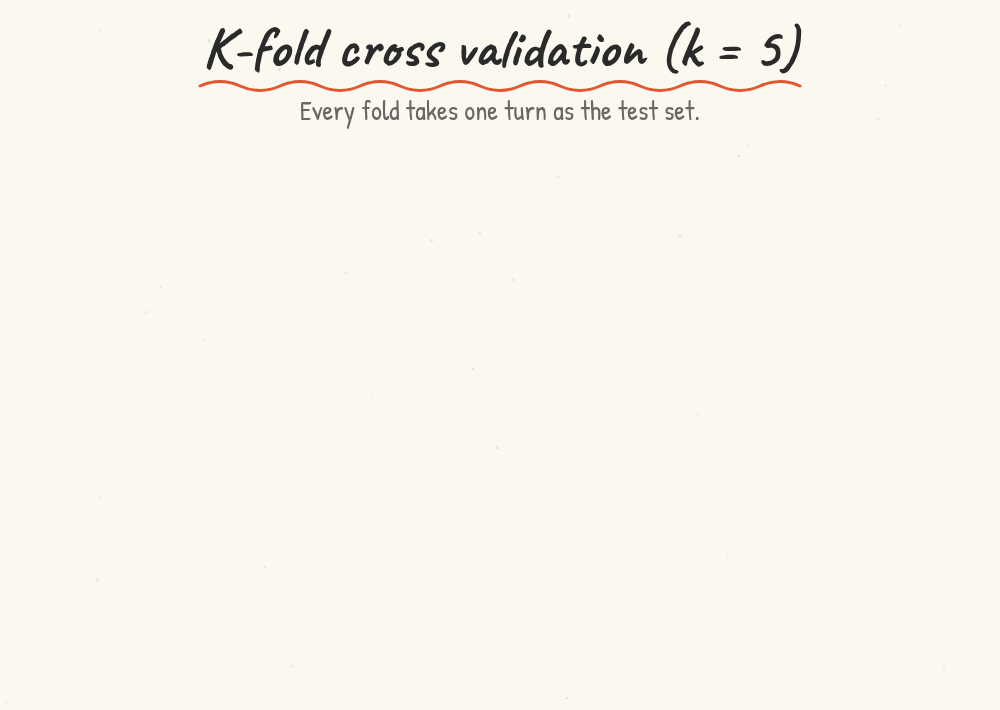
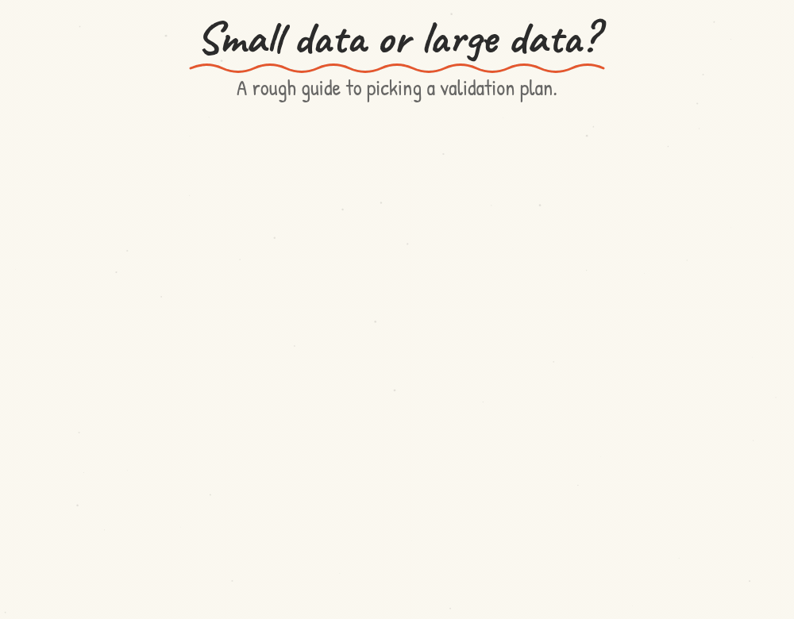
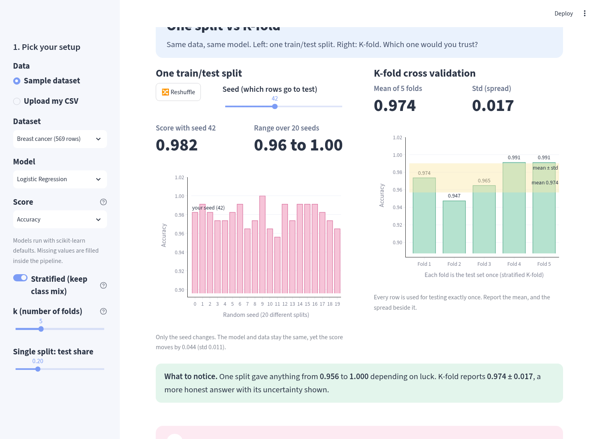
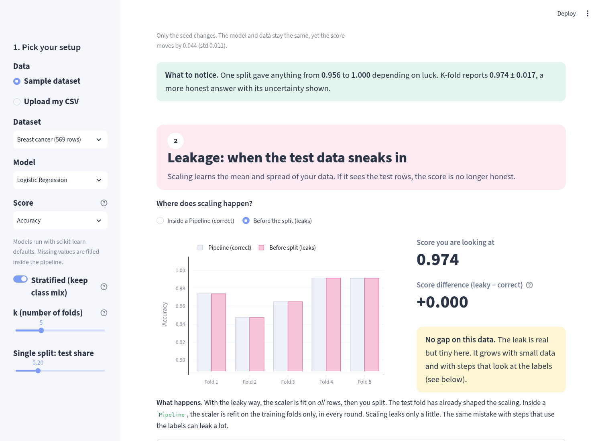
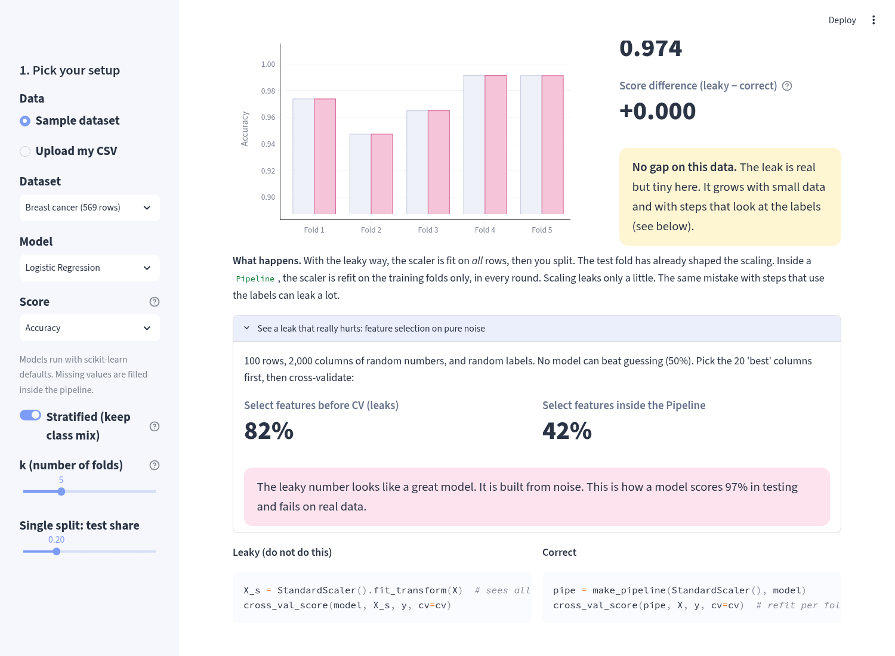
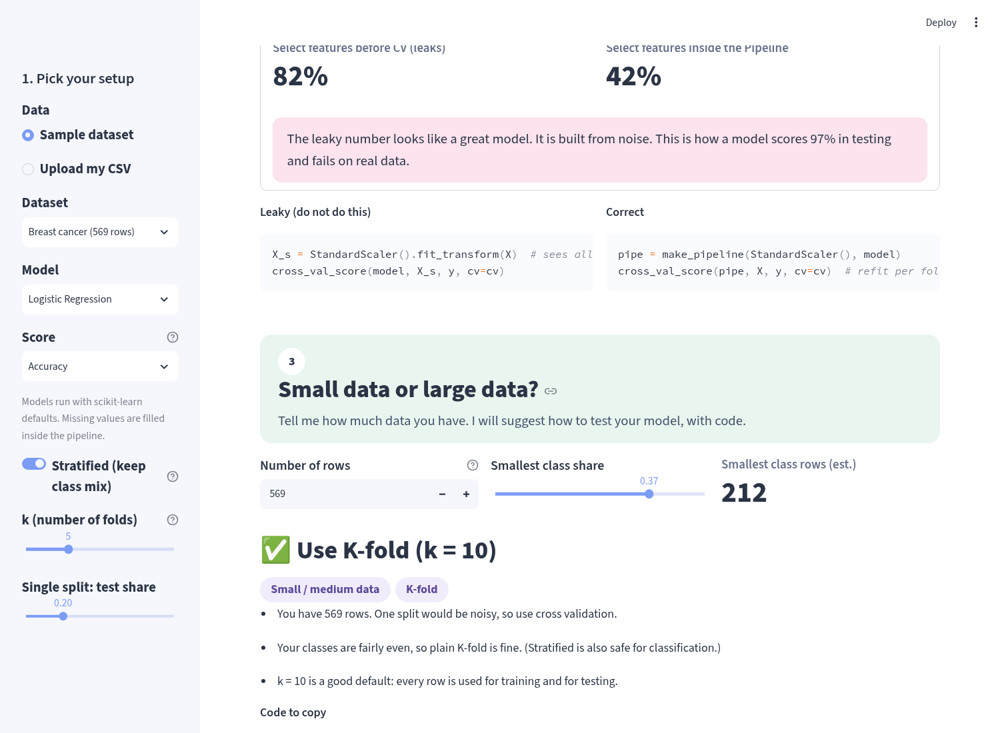

# Your Model Scored 97%, Then Failed on Real Data: How to Build and Test It the Right Way

*By Nagaraju Poralla*

[Category: Evaluations & Reliability](../README.md) · [Community category](https://aiengineer.help/c/evaluations-reliability/8)



Most of the time the model is not the problem. The way it was tested is. This guide shows how to build an ML model and check it properly with K-fold cross validation.

We go from the basic workflow to K-fold cross validation, and we finish with which method to use for small data and which for large data. There is working scikit-learn code with real output.

---

## 1. The ML workflow

Every model follows the same path.

1. **Data.** Collect rows and labels.
2. **Clean.** Fix missing values and errors.
3. **Split.** Set aside data for training, validation, and testing.
4. **Train.** The model learns patterns from the training data.
5. **Validate.** Tune settings and compare models.
6. **Test.** Get one final, honest score.
7. **Deploy.** Use the model on new data.



*Figure 1. The ML workflow, from raw data to a working model.*

Notice that the split comes before training. That is on purpose. The next section explains why.

---

## 2. Why we split the data

A model can memorize its training data. This is called **overfitting**. It scores very well on data it has seen, and badly on new data.

If you test the model on the same rows it trained on, you learn nothing. The score looks great, but it only tells you how well the model remembers. It does not tell you how well it predicts.

So we keep some data hidden. The model never trains on it. Most projects split the data into three parts:

- **Training set.** The model learns from it.
- **Validation set.** You use it to tune settings and to choose between models.
- **Test set.** You use it once, at the end, for the final score.



*Figure 2. Three parts of the data. Each part has one job.*

Common splits are 70/15/15 or 80/10/10.

Why do we need both a validation set and a test set? Tuning on a set slowly fits your choices to that set. Once you have tuned on the validation set, its score is a little too good. The test set has not been touched, so its score is fair.

There is a second risk called **data leakage**. It happens when information from the test data slips into training. The score then looks better than it should. We cover common causes near the end of this post.

---

## 3. K-fold cross validation

A single split has one weakness. The score depends on which rows landed in the validation set.

With a lot of data, this does not matter much. With little data, it matters a lot. A lucky split gives a high score. An unlucky split gives a low one. Also, if you have only 500 rows and set aside 20%, then 100 rows are never used for learning.

K-fold cross validation fixes both problems. Here is the idea with k = 5.

1. **Shuffle** the data and cut it into 5 equal parts. Each part is called a fold.
2. **Round 1.** Use fold 1 as the test fold. Train on folds 2, 3, 4, and 5. Record the score.
3. **Round 2.** Use fold 2 as the test fold. Train on the other four. Record the score.
4. **Repeat** until every fold has been the test fold once. That is 5 rounds and 5 scores.
5. **Average** the 5 scores. This is your estimate of how the model performs.
6. **Retrain** the model on all the data. This final model is the one you use.



*Figure 3. K-fold with k = 5. Every fold is the test fold once. The scores shown are real, from the code below.*

Two points to remember:

- Every row is used for training, and every row is used for testing. Nothing is wasted.
- The 5 models from the rounds are only for scoring. You throw them away. Then you train the final model on all the data.

The average is more stable than a single split. The spread between the folds also shows you how much the score can change.

---

## 4. Small data or large data?

The right method depends on how much data you have. The numbers below are rough guides, not hard rules.



*Figure 4. A rough guide to picking a validation plan.*

### Small data (a few thousand rows or fewer)

Every row counts, and one split is noisy. So use cross validation.

- Use **K-fold with k = 5 or 10**.
- Use **stratified** K-fold if the classes are uneven.
- Use **LOOCV** if the data is very tiny, such as a few dozen rows.
- Use **repeated** K-fold if you want a steadier score.

### Large data (hundreds of thousands to millions of rows)

Use a simple **hold-out split**: one train, validation, and test split.

- For 100,000 or more rows, 80/10/10 works well.
- For millions of rows, 98/1/1 is fine. One percent of a million rows is still 10,000 rows.

Why not K-fold here? It trains the model k times. With k = 5, that is five times the cost. With big models or big data, that cost is real, and it buys little. A validation set of tens of thousands of rows already gives a stable score.

If your data is somewhere in between, either approach is fine. Pick the one your compute budget allows.

Even with K-fold, it is good practice to keep a small test set aside first. Run K-fold on the rest, and use the test set once at the end.

---

## 5. Variants of K-fold

Plain K-fold is a good default. Some data needs a different version.

- **Stratified K-fold.** Use it when classes are imbalanced. For example, 5% of rows are fraud and 95% are not. Each fold keeps the same class mix as the full data. Without this, a fold could end up with almost no fraud rows. For classification, it is usually the better default.
- **Repeated K-fold.** Run K-fold several times, with a different shuffle each time. You get more scores to average, so the result is steadier. It costs more training time.
- **Leave-one-out (LOOCV).** This is K-fold where k equals the number of rows. Each round tests on exactly one row. It uses the most data for training in every round, but it trains the model once per row. Only use it on very small data.
- **Group K-fold.** Use it when rows are not independent. For example, one patient has many rows. If the same patient's rows land in both training and test, the model can recognize the patient. Group K-fold keeps each group on one side only.
- **Time-series split.** Use it for data ordered by time. Never train on the future and test on the past. Each round trains on earlier data and tests on the data just after it. Do not shuffle.

---

## 6. Code: K-fold in scikit-learn

This example uses the breast cancer dataset that ships with scikit-learn. It has 569 rows and 30 features.

```python
from sklearn.datasets import load_breast_cancer
from sklearn.linear_model import LogisticRegression
from sklearn.model_selection import KFold, StratifiedKFold, cross_val_score
from sklearn.pipeline import make_pipeline
from sklearn.preprocessing import StandardScaler

X, y = load_breast_cancer(return_X_y=True)

# The scaler is inside the pipeline, so it is fit on training folds only.
model = make_pipeline(StandardScaler(), LogisticRegression(max_iter=1000))

kf = KFold(n_splits=5, shuffle=True, random_state=42)
scores = cross_val_score(model, X, y, cv=kf, scoring="accuracy")
print("Fold scores:", scores.round(3))
print(f"Mean: {scores.mean():.3f}  Std: {scores.std():.3f}")

skf = StratifiedKFold(n_splits=5, shuffle=True, random_state=42)
scores = cross_val_score(model, X, y, cv=skf, scoring="accuracy")
print("Fold scores:", scores.round(3))
print(f"Mean: {scores.mean():.3f}  Std: {scores.std():.3f}")

# Final step: retrain on all the data.
model.fit(X, y)
```

I ran this with scikit-learn 1.9.1. This is the real output:

```text
KFold (k=5)
Fold scores: [0.974 0.982 0.965 0.991 0.973]
Mean: 0.977  Std: 0.009

StratifiedKFold (k=5)
Fold scores: [0.974 0.947 0.965 0.991 0.991]
Mean: 0.974  Std: 0.017
```

The five scores differ a little, from 0.965 to 0.991. A single split would hide that spread. The average, about 0.97, is a better estimate than any one fold. Your numbers may differ slightly with another scikit-learn version.

---

## 7. Common mistakes

**Scaling before the split.** If you scale the whole dataset first, the scaler learns the mean and spread of the test rows too. That is leakage. Split first. Fit the scaler on the training data only, then apply it to the test data. In K-fold, put the scaler inside a `Pipeline`, as in the code above. Then it is refit inside every round. The same rule applies to filling missing values, selecting features, and any other step that learns from data.

**Tuning on the test set.** If you look at the test score, change the model, and look again, the test set is no longer a test. It has become a second validation set. Use the test set once.

**Tuning and scoring on the same folds.** If you pick settings with cross validation and then report that same cross validation score, the score is a little optimistic. The fix is **nested cross validation**. An inner loop picks the settings. An outer loop gives the score. It costs more, so use it mainly on small data.

**Ignoring the data type.** Use stratified K-fold for imbalanced classes. Use group K-fold for grouped rows. Use a time-series split for time data. A plain shuffle on these can give a score that is too high.

---

## Summary

- The workflow is: data, clean, split, train, validate, test, deploy.
- We split to catch overfitting and to avoid leakage.
- K-fold tests every fold once, averages the scores, then retrains on all the data.
- Small data: K-fold with k = 5 or 10, stratified for uneven classes, LOOCV for tiny data.
- Large data: one hold-out split, such as 80/10/10, or 98/1/1 for millions of rows.
- Fit every learning step, including scaling, on training data only.
- Touch the test set once.

---

## Try it yourself: Validation Playground

This folder also holds **Validation Playground**, a small Streamlit app that lets you try the ideas above instead of only reading them.

- Live demo: [validation-playground.onrender.com](https://validation-playground.onrender.com) (free Render plan: it sleeps when idle, so the first load can take about a minute)
- Original repository: [Porallanagaraju13/Validation-Playground](https://github.com/Porallanagaraju13/Validation-Playground)



| Section | The one idea |
| --- | --- |
| **1. One split vs K-fold** | One train/test split is luck. Press **Reshuffle** (or drag the seed) and watch the score jump, with a chart of the score on 20 different seeds. Next to it, K-fold gives one bar per fold plus the mean and standard deviation. A **Stratified** toggle keeps the class mix in every fold. |
| **2. Leakage** | A switch compares scaling **before the split** (leaks) with scaling **inside a `Pipeline`** (correct), shows both scores and the difference, and explains why. A bonus demo on pure noise shows a leak that fakes 80%+ accuracy. |
| **3. Small data or large data?** | Enter a row count and class balance. The advisor recommends K-fold, stratified K-fold, LOOCV or a hold-out split, explains why, and gives code to copy. |
| **4. Your setup as code** | The exact scikit-learn code for the settings you picked. |

**Data:** breast cancer, wine, iris, a synthetic imbalanced set (5% positive), or your own CSV (choose the target column; classification only; text columns are one-hot encoded and missing values are filled inside the pipeline). **Models:** Logistic Regression, Random Forest, Decision Tree. **k:** 3 to 10. **Score:** accuracy, balanced accuracy or macro F1.







### An honest note on scaling leakage

Scaling before the split leaks only a little. On the breast cancer data the gap is between 0.000 and about 0.007 depending on dataset and folds, and tree models (Decision Tree, Random Forest) do not care about feature scale at all. The playground shows the true number and does not exaggerate it. Steps that use the **labels**, such as selecting the best features, can leak a lot, which is why the noise demo is included.

## Run it locally

Prerequisites: Python 3.12 or newer and [uv](https://docs.astral.sh/uv/). Dependencies are declared in `pyproject.toml` and locked in `uv.lock`.

From this directory (`evaluations-reliability/validation-playground/`):

```bash
uv sync --locked
uv run streamlit run app.py
```

Open http://localhost:8501. No API keys or environment variables are needed, and the app makes no network calls. Your uploaded CSV stays in the running session.

The lock file resolves scikit-learn 1.9.1, the version used for the numbers in the post. If you prefer pip, `pip install -r requirements.txt` installs the same pinned versions into a virtual environment.

## Check it

```bash
uv run pytest
uv run ruff check .
```

Expected: `57 passed` (about a minute) and `All checks passed!`. The tests make no network calls and need no keys:

- `tests/test_validation_lib.py` checks the helpers offline: CSV preparation, the advisor's recommendations and that its code snippets compile, the feature-selection leak on noise, and that the post's K-fold example reproduces its reported fold scores (0.974, 0.982, 0.965, 0.991, 0.973; mean 0.977).
- `tests/test_app.py` runs the app headlessly with Streamlit's `AppTest` for every dataset, model, score, stratified on/off, the leakage switch, k = 3 and 10, and the reshuffle button, and fails if any combination raises an error.

These tests show that the app runs and that the key numbers reproduce; they do not check the statistics against an independent reference.

## Files

- `app.py`: the Streamlit app (layout and charts)
- `validation_lib.py`: data loading, models, experiments and the advisor (plain scikit-learn)
- `tests/`: the pytest checks described above
- `pyproject.toml` and `uv.lock`: dependencies and their lock; `requirements.txt` is the same pins exported for pip and Render
- `sample_data/customer_churn_sample.csv`: a small synthetic CSV to try the upload (target column: `churned`)
- `.streamlit/config.toml`: the light theme and upload limit
- `render.yaml`: the Render web-service config used for the live demo (build `pip install -r requirements.txt`, start `streamlit run app.py --server.port $PORT --server.address 0.0.0.0`)
- `docs/`: the cover and the four figures; `screenshots/`: the app screenshots used above

## Costs and limitations

- No paid APIs. The live demo runs on Render's free plan.
- The numbers in the post (scikit-learn 1.9.1, `random_state=42`) are from one run; other scikit-learn versions can differ in the last digit. The thresholds for small and large data are rough guides, not rules.
- The advisor and the playground cover tabular classification only. They do not cover regression, time-series splits or group K-fold in the app (the post explains them).
- The four built-in datasets ship with scikit-learn or are generated; the sample CSV is synthetic. Do not upload private data to the public demo.

## Sources

- scikit-learn documentation: [Cross-validation: evaluating estimator performance](https://scikit-learn.org/stable/modules/cross_validation.html)
- scikit-learn documentation: [Common pitfalls and recommended practices](https://scikit-learn.org/stable/common_pitfalls.html) (data leakage and pipelines)

## License

MIT, see [LICENSE](LICENSE). The repository does not have a license yet; please flag it if you would prefer a different approach.
