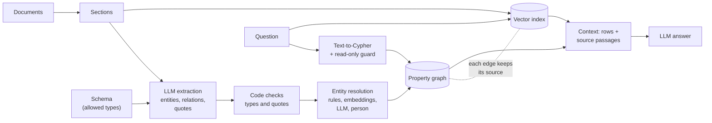
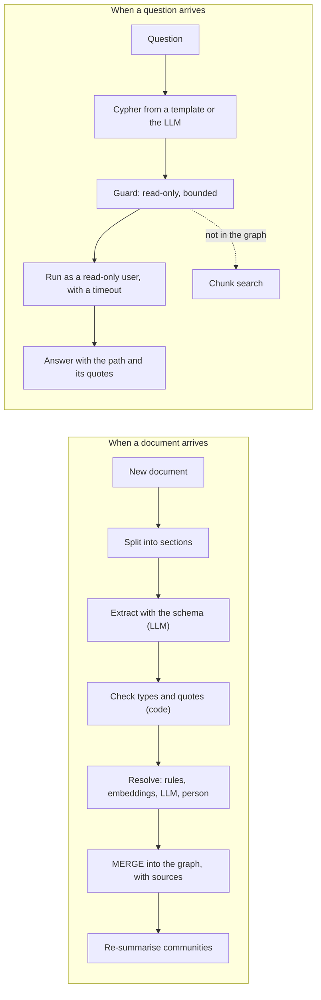

# Knowledge graphs for AI engineers: when GraphRAG beats chunk search, and when it doesn't

Most retrieval-augmented generation (RAG) systems work on chunks. They split documents into passages, embed them, and hand the model the few passages most similar to the question. That works when the answer sits in one passage. It fails when the answer is spread across documents that don't mention each other. "Which customers would be affected by a delay in QX-7 radio chip shipments?" needs a product brief (the chip goes into the Atlas-3), a launch note (and into the Meridian), and three account documents (who runs those products). None of those passages looks like the question.

A knowledge graph stores the facts inside documents as entities and the relations between them, so code can follow relations from one entity to the next, however far apart the documents that stated them. This article explains what a knowledge graph is, how to build one from text with an LLM, and how to query it. It then measures the whole pipeline on a small corpus: Gemini extracts the facts (three times, to see how much they vary), names are merged by rules, an LLM and a person, the graph is loaded into Neo4j, and 15 questions are answered five ways. Every number below comes from those recorded runs, mistakes included.

**Try it:** this folder contains a web app that replays the runs: the question, what a knowledge graph is, a walkthrough of six documents being extracted, merged and queried, the results, where the graph loses, who does what, and how to take it to production. Run locally with Neo4j and a Gemini key, it also answers your own questions. See [The demo app](#the-demo-app).

## Key takeaways

1. **A knowledge graph turns sentences into connections code can follow.** "The Atlas-3 main board uses the QX-7 radio chip" and "Osterby Water Utility runs 420 Atlas-3 units" live in different documents. In a graph they are two edges, and one query walks from the chip to the customer.
2. **On the multi-hop question, the graph found 4 of 4 customers; chunk search found 0 of 4**, with TF-IDF and with Gemini embeddings alike. Across all 15 questions, chunk search with embeddings found 18 of 41 needed facts, Gemini-written Cypher found 30 of 41, and a simple hybrid 31 of 41.
3. **The graph loses on prose.** "What did the QX-7 incident review recommend?" scored 2 of 2 with chunk search and 0 of 2 with the graph: a recommendation is not a relation between two entities, so it never became an edge.
4. **The model makes mistakes at every stage, and the demo shows them.** In one extraction run of 69 relations, 1 was wrong and 1 not stated by the text, and 2 entities were mistyped. A rule-and-LLM resolution left 2 entities split until a person merged them. Generated Cypher ignored dates on edges and returned an outdated owner, and once returned nothing until repaired.
5. **It is cheap at this size, and the cost is at indexing time.** The whole experiment (three extraction runs, resolution, every question with every method, the judge) was 300 Gemini calls for $0.32.
6. **The work is split between an LLM, code and a person.** The LLM extracts and writes queries; code validates the facts, merges names by rules, guards the queries and scores the answers; a person owns the schema and settles the merges the LLM is unsure about.

## What a knowledge graph is

A knowledge graph is a set of **nodes** (entities: a person, a product, a company) connected by **edges** (relations: *leads*, *supplies*, *uses*). Both can carry **properties**, such as `units: 420` on the edge *Osterby Water Utility USES Atlas-3*. A **schema** (in the semantic-web world, an **ontology**) says which entity types and relation types exist and which types each relation may connect, for example that `SUPPLIES` goes from a `Company` to a `Component`.

Written as triples, two facts from the example corpus:

```text
(Varnell Semiconductor) -[SUPPLIES]-> (QX-7 radio chip)
(Osterby Water Utility) -[USES {units: 510}]-> (Atlas-3)
```

| Term | Meaning |
| --- | --- |
| Entity | A thing the documents talk about: a person, team, product, part, supplier or customer |
| Relation | A typed link between two entities, such as `SUPPLIES`, `PART_OF` or `USES` |
| Triple | One fact, entity → relation → entity, kept with the exact sentence it came from |
| Entity resolution | Deciding that two names, such as "Varnell Semi" and "Varnell Semiconductor", are the same entity, and merging them |
| Traversal | Answering by following relations from one entity to the next, one hop at a time (here, a Cypher query on Neo4j) |
| Schema | The allowed entity types and relations, and which types each relation may connect |

There are two common ways to store a graph:

| | Property graph | RDF |
| --- | --- | --- |
| Data model | Nodes and relationships, each with labels and key-value properties | Triples of subject, predicate and object, identified by IRIs ([RDF 1.1](https://www.w3.org/TR/rdf11-concepts/)) |
| Query language | Cypher (Neo4j, Memgraph and others), or ISO GQL, published in 2024 as [ISO/IEC 39075](https://webstore.iec.ch/publication/94107) | [SPARQL 1.1](https://www.w3.org/TR/sparql11-query/) |
| Properties on edges | Built in | Need extra modelling (reification or RDF-star) |
| Strengths | Simple to start with, popular in GraphRAG tooling | Global identifiers, shared vocabularies, reasoning over formal ontologies |

Most GraphRAG libraries target property graphs and Cypher, and so does this example.

### Chunk RAG, graph RAG and hybrid

| | Chunk (vector) RAG | Knowledge-graph RAG | Hybrid |
| --- | --- | --- | --- |
| Index | Embedded passages | Entities and relations extracted by an LLM | Both, linked: each edge points back to the passage it came from |
| Indexing cost | One embedding per chunk | At least one LLM call per chunk, plus resolution | Both |
| Good at | Questions answered by one or two passages; wording and detail | Multi-hop questions, "how is X connected to Y", counting and listing across documents | Both kinds, at the cost of more context |
| Weak at | Facts spread over passages that don't resemble the question | Anything extraction didn't capture: reasons, recommendations, nuance | More moving parts |
| Fails by | Returning the wrong passages | Missing or wrong edges, unmerged duplicates, wrong queries | Either, less often |

## How GraphRAG works



The survey by [Peng et al. (2024)](https://arxiv.org/abs/2408.08921) splits the workflow into graph-based indexing, graph-guided retrieval and graph-enhanced generation. In practice the steps are these.

### 1. Extraction

An LLM reads one chunk at a time and returns entities and relations as structured output that matches a JSON schema. Give it the schema: the allowed entity types, the allowed relation types, and which types each relation connects. Without one, the model invents a new relation name for every sentence (`IS_MADE_BY`, `MANUFACTURES`, `PRODUCES`) and the graph can't be queried reliably.

The libraries expose this directly. LangChain's [`LLMGraphTransformer`](https://reference.langchain.com/python/langchain-neo4j/graph_transformers/llm/LLMGraphTransformer) takes `allowed_nodes` and `allowed_relationships` and with `strict_mode` filters out anything outside them. LlamaIndex's [`PropertyGraphIndex`](https://developers.llamaindex.ai/python/framework/module_guides/indexing/lpg_index_guide/) offers `SchemaLLMPathExtractor` for a strict schema. Microsoft GraphRAG's [default pipeline](https://microsoft.github.io/graphrag/index/default_dataflow/) extracts entities and relationships with descriptions from text units.

Ask the model for **evidence** too: the exact sentence that states each relation. Code can then check that the sentence really is in the document, and retrieval can return it beside the edge.

### 2. Entity resolution

Extraction runs per chunk, so the same thing arrives under different names: here "Varnell Semi", "Varnell" and "Varnell Semiconductor"; "A3", "Atlas 3" and "Atlas-3"; "TGW" and "Telemetry Gateway". Common approaches, from cheapest to most expensive:

- **Exact match after normalizing** case and punctuation ("Atlas 3" = "Atlas-3").
- **Abbreviation and initial rules** ("T. Berg" = "Tomas Berg"). Neo4j's `neo4j-graphrag` package ships [exact, fuzzy (RapidFuzz) and spaCy-similarity resolvers](https://neo4j.com/docs/neo4j-graphrag-python/current/_modules/neo4j_graphrag/components/resolver.html).
- **Embedding similarity to propose candidates, and an LLM or a person to decide**, for names no rule can match.

Always restrict merges to the same type, and never merge a name that could refer to more than one entity. A wrong merge is worse than a missed one: it connects facts that have nothing to do with each other.

### 3. Storing and querying

Load the resolved entities and relations into a graph store. A Cypher query names a pattern, and the database finds every match. This is the query Gemini wrote for the QX-7 question:

```cypher
MATCH (c:Component)-[:PART_OF]->(p:Product)<-[:USES]-(cust:Customer)
WHERE toLower(c.name) CONTAINS 'qx-7 radio chip'
   OR any(alias IN c.aliases WHERE toLower(alias) CONTAINS 'qx-7 radio chip')
RETURN DISTINCT cust.name AS customer, p.name AS product
```

### 4. Retrieval patterns

| Pattern | How it works | Good for | Examples |
| --- | --- | --- | --- |
| **Local (entity neighbourhood)** | Find the entities the question mentions, then return their neighbours, relations and linked passages | "Tell me about X" | GraphRAG [local search](https://microsoft.github.io/graphrag/query/local_search/), LightRAG `local` mode |
| **Multi-hop traversal** | Follow a relation pattern or a path from the linked entities | Supply chains, ownership, impact analysis | Cypher `MATCH`, HippoRAG's Personalized PageRank |
| **Text-to-Cypher** | An LLM writes the query from the schema and the question; the database runs it | Precise filters, counts and aggregations | neo4j-graphrag `Text2CypherRetriever`, LangChain `GraphCypherQAChain` |
| **Community summaries (global)** | Cluster the graph into communities, have an LLM summarize each, then map-reduce the summaries | "What are the main themes across the corpus?" | Microsoft GraphRAG [global search](https://microsoft.github.io/graphrag/query/global_search/) |
| **Hybrid vector + graph** | Vector search finds entry passages or nodes; a graph query expands from them; both go into the context | Most production systems | neo4j-graphrag `VectorCypherRetriever`, LightRAG `hybrid` and `mix` modes |

**Community summaries** answer questions about the whole corpus. Edge et al. ([*From Local to Global*, 2024](https://arxiv.org/abs/2404.16130)) build an entity graph, summarize communities of closely related entities, answer from each summary and merge the partial answers, and report gains over conventional RAG in comprehensiveness and diversity on global questions over corpora in the one-million-token range. The price is many LLM calls at indexing time; Microsoft's [LazyGraphRAG](https://www.microsoft.com/en-us/research/blog/lazygraphrag-setting-a-new-standard-for-quality-and-cost/) describes indexing costs "identical to vector RAG and 0.1% of the costs of full GraphRAG", by deferring LLM use to query time.

**[LightRAG](https://arxiv.org/abs/2410.05779)** combines graph structure with vector retrieval at two levels (specific entities and broader themes) and supports incremental updates. **[HippoRAG](https://arxiv.org/abs/2405.14831)** runs Personalized PageRank over an extracted graph, seeded from the question's entities, and reports up to 20% better multi-hop QA than prior methods.

## The experiment

### The corpus, the schema and the questions

Corvane Instruments is a fictional maker of water-quality sensors. The corpus is 25 short Markdown documents in [`corpus/`](corpus/), 62 paragraphs in all: org updates, product briefs, a supplier register, account notes, incident reviews, emails, a newsletter, and some unrelated distractors (an office move, a cafeteria memo). Every name is invented and the corpus was written for this example. It is built to contain the things that make real extraction hard:

- **Aliases:** Varnell Semi, Varnell and Varnell Semiconductor; QX7 modem and QX-7; A3 and Atlas 3; TGW; T. Berg; M. Feld.
- **A trap:** Varnell Bay Marina, a customer whose short name is also "Varnell".
- **Facts that change:** Osterby runs 420 Atlas-3 units in February and 510 in August; the Telemetry Gateway moves from the Firmware team to the Data Platform team on 1 September 2026; the Atlas-3 switches battery from the LX-4 to the Sundra C2.
- **Prose-only facts:** recommendations and reasons that are not relations between entities.

The schema ([`data/schema.json`](data/schema.json)) has 9 entity types and 13 relation types. The same file builds the extraction prompt, the structured-output JSON schema, the validation rules and the text-to-Cypher prompt.

The 15 questions ([`data/questions.json`](data/questions.json)), their correct answers, and the facts each answer needs, with the sentences that support them, were **written by hand and committed before any model ran** (commit `e0ee82d`), along with 42 gold entities ([`data/gold-entities.json`](data/gold-entities.json)) for scoring resolution.

### Extraction: three runs of Gemini

Each document was sent to `gemini-3.8-flash` through the Interactions API with the schema as structured output (temperature 0, thinking level low), three times. Code then checked every entity type, every relation's source and target types, and that every quote is verbatim in the document.

| Run | Entities | Relations | Rejected by validation | Cost |
| --- | --- | --- | --- | --- |
| 1 | 125 | 69 | 0 | $0.056 |
| 2 | 122 | 67 | 0 | $0.054 |
| 3 | 120 | 70 | 0 | $0.061 |

**The runs mostly agree, not completely.** Jaccard agreement on facts (source, relation, target) between runs was 0.964, 0.912 and 0.912. Of the 58 distinct facts in any run, 52 appeared in all three and 5 in only one, for example `Calder Grain Co-op USES QX-7` (run 3 skipped the product) and `QX-7 shipment delay AFFECTED QX-7 radio chip`.

**The author reviewed run 1** ([`data/extraction-review.json`](data/extraction-review.json)), and found:

- **A wrong fact:** `LX-4 PART_OF Atlas-3`, from "From the May build, the Atlas-3 uses the Sundra C2 cell from Sundra Power instead of the LX-4 lithium cell." The model turned the replaced part into a current part.
- **A fact the text doesn't state:** `Varnell Semiconductor SUPPLIES QX-7 radio chip` from the incident review, which only says shipments would slip. True elsewhere in the corpus, but not in that quote.
- **Two type errors:** "QX-7" typed as a Product in an email, and "Meridian" typed as a Customer in "driven by Meridian pilots".
- **Two spurious entities:** "Atlas team" and "Harbour Street", which no question needs.

Validation caught none of these: each quote was verbatim and each type was allowed. They are errors of meaning, which only a review against the text finds.

### Resolution: rules, then an LLM, then a person

The 125 extracted entities from run 1 carry 68 distinct names. Resolution ([`src/resolve.ts`](src/resolve.ts), [`src/pipeline/resolve-run.ts`](src/pipeline/resolve-run.ts)) has three stages:

1. **Rules (code).** Same type, and the names are equal after normalizing, or one is an abbreviation or initials of the other. A name that fits two entities is refused. 68 names → 51 entities.
2. **Embeddings and an LLM.** `gemini-embedding-2` embeds every name with its context; pairs of the same type above cosine 0.7 go to Gemini with the sentences they came from. Of 135 pairs checked, it said *same* to 2 (QX7 = QX-7 radio chip, TGW = Telemetry Gateway), *different* to 122 and *unsure* to 11. 51 → 49 entities.
3. **A person.** The 11 unsure pairs went to a review queue. The author's decisions are in [`data/review.json`](data/review.json): 2 merges (A3 = Atlas-3, Support = Customer Support) and 9 refusals. 49 → **47 entities**.

| Stage | Entities | False merges | False splits |
| --- | --- | --- | --- |
| Rules and LLM | 49 | 0 | 2 (Atlas-3 / A3, Customer Support / Support) |
| After the person | 47 | 0 | 0 |

Measured against the 42 gold entities. Three names have no gold entity (Harbour Street, Atlas team, sales team) and the two type errors remain. Until the person merged "A3", Brightwater Aquaculture's order hung off a separate node, invisible to every Atlas-3 question.

**The type rule matters.** Without it, the same rules would have merged "Telemetry Gateway outage" (an Incident) into "Telemetry Gateway" (a Service), and refused "Varnell" and "QX-7" as ambiguous: "Varnell" could be Varnell Semiconductor or the Varnell Bay Marina.

### The graph

[`src/graph.ts`](src/graph.ts) builds the graph from run 1 and the reviewed entities: **47 nodes and 54 edges**. Every edge keeps its provenance: the document, its date, the quote and the run. A value stated twice keeps both, with the date of each, and the latest as the current value (`units: 510`, with `units_values: [420, 510]`). The graph is loaded into Neo4j `2026.09.0` Community with `MERGE` and a uniqueness constraint on entity ids.

### Questions, five ways

Each question was answered five ways, with *k* = 3 passages for chunk search:

- **Chunk search (TF-IDF):** paragraphs ranked by TF-IDF cosine.
- **Chunk search (embeddings):** paragraphs ranked by `gemini-embedding-2` similarity.
- **Graph, Gemini writes the query:** Gemini gets the schema, the entity names and the question and writes Cypher; the guard checks it; Neo4j runs it in a read transaction with a timeout. If it fails or returns no rows, Gemini gets one repair attempt with the error.
- **Graph, hand-written query:** the gold Cypher from `questions.json`, as a ceiling for text-to-Cypher.
- **Hybrid:** the embedding hits, plus the graph edges around every entity those passages mention.

A needed fact counts as found when the retrieved context holds it: for passages, every sentence of its supporting chain; for graph rows, the answer's value. Wrong or outdated values that appear are counted separately. The global question is graded by an LLM judge. These are the measured results (`npm run report` prints them):

| Question | Kind | TF-IDF | Embeddings | Gemini Cypher | Gold Cypher | Hybrid |
| --- | --- | --- | --- | --- | --- | --- |
| Which customers would be affected by a delay in QX-7 radio chip shipments? | Multi-hop | 0/4 | 0/4 | **4/4** | 4/4 | 0/4 |
| How many customers depend on parts made by Varnell Semiconductor? | Aggregation | 0/6 | 0/6 | 0/6, count right | 6/6 | 2/6 |
| Osterby's sensors stopped uploading. Which team and team lead should get the ticket today? | Multi-hop, changed over time | 0/2 ⚠1 | 0/2 ⚠1 | 2/2 ⚠1 | 2/2 | 2/2 ⚠1 |
| How is Pellham Labs connected to Varnell Semiconductor? | Connection | 1/3 | 1/3 | 3/3 | 3/3 | 3/3 |
| Who leads the Firmware team? | Single fact | 1/1 | 1/1 | 1/1 | 1/1 | 1/1 |
| What did the QX-7 incident review recommend? | Detail in prose | **2/2** | **2/2** | 0/2 | 0/2 | 2/2 |
| What are the main supply risks across these documents? | Global | 1/4 | 2/4 (judge) | 2/4 (judge) | – | 2/4 (judge) |
| How many Atlas-3 units does Osterby Water Utility run? | Single fact, changed over time | 1/1 ⚠1 | 1/1 ⚠1 | 1/1 | 1/1 | 1/1 ⚠1 |
| Which components go into the Atlas-3 today, and who supplies each? | Aggregation | 0/4 | 2/4 ⚠1 | 4/4 ⚠1 | 4/4 ⚠1 | 4/4 ⚠1 |
| Which companies can supply the QX-7 radio chip? | Single hop, changed over time | 2/2 | 2/2 | 2/2 | 2/2 | 2/2 |
| Which customers were affected by the Telemetry Gateway outage on 14 May 2026? | Multi-hop | 0/5 | 0/5 | 5/5 ⚠1 | 5/5 | 5/5 ⚠1 |
| Which accounts does Lena Vik manage? | Aggregation | 3/3 | 3/3 | 3/3 | 3/3 | 3/3 |
| Why did the Atlas-3 switch to a different battery cell? | Detail in prose | 0/1 | 1/1 | 0/1 | 0/1 | 1/1 |
| Which products does the team led by Tomas Berg own? | Multi-hop | 2/2 | 2/2 | 2/2 | 2/2 | 2/2 |
| Where is the Meridian flow meter assembled? | Single fact | 1/1 | 1/1 | 1/1 | 1/1 | 1/1 |
| **All questions** | | **14/41** | **18/41** | **30/41** | **34/37** | **31/41** |
| Questions complete | | 7 of 15 | 8 of 15 | 11 of 15 | 12 of 14 | 12 of 15 |
| Wrong or outdated values | | 2 | 3 | 3 | 1 | 4 |

⚠ marks a wrong or outdated value in the context, such as the Firmware team as the gateway's owner today, or 420 units. The gold Cypher has no query for the global question, so it is scored on 14.

The final answers, written by Gemini from each method's context, found 19 of 41 facts from embeddings, 30 of 41 from the generated Cypher (3 with a wrong value), and 26 of 41 from the hybrid.

#### Where chunk search misses a hop

For the QX-7 question, embeddings returned the Kerrin second-source email (similarity 0.805), the supplier register (0.796) and the incident review (0.784). They are about the chip and the delay, and none names a customer. The sentences that do, "Osterby Water Utility runs 420 Atlas-3 units" and "Brightwater Aquaculture has ordered 80 A3 sensors", share nothing with a question about radio chips; the link exists only through a third document. TF-IDF did no better.

The graph started at the QX-7 radio chip, followed `PART_OF` to the Atlas-3 and the Meridian, and `USES` back to four customers. Gemini's answer: "The customers affected would be Osterby Water Utility, Calder Grain Co-op, and Brightwater Aquaculture (which use the Atlas-3), as well as Northmoor Irrigation District (which uses the Meridian)."

The hybrid scored 0 of 4 here too: the passages it starts from mention the chip and its suppliers, not the products, so a one-hop expansion never reaches the customers.

#### Where the graph loses

"What did the QX-7 incident review recommend?" The answer, "qualify a second radio-chip supplier by the end of Q3 and keep eight weeks of chip stock on hand", is a recommendation. The schema has no relation for it, so extraction produced none. The graph query returned the incident's relations (it involved Varnell Semiconductor, it affected the QX-7), and Gemini answered that the results "do not contain any information about recommendations". Chunk search ranked the recommendation in its top three. The battery question ("why did the Atlas-3 switch?") failed the same way.

#### Where the generated query went wrong

- **It ignored time.** For "which team should get the ticket today?", the query returned both owners of the Telemetry Gateway, the Firmware team and the Data Platform team, without using the dates on the edges. Gemini's answer: "Either of these teams and their respective leads could receive the ticket."
- **It returned nothing, then too much.** For the outage question, the first query looked for customers linked straight to the incident and returned 0 rows. The repair went through products and returned 6 customers, including Varnell Bay Marina, which became a customer a month after the outage.
- **It counted instead of listing.** For "how many customers depend on Varnell?", the query returned `count: 6`. The count is right; the names the scoring needs were never returned.
- **Rows without their query mean nothing to the model.** In the first answering pass, Gemini saw only the rows, and for "which accounts does Lena Vik manage?" answered "The provided context does not mention Lena Vik", although the rows were exactly her three accounts. Giving it the query beside the rows fixed this; both passes are kept in [`results/answers.json`](results/answers.json) (`firstTry`).

#### The global question

"What are the main supply risks across these documents?" has no entity to start from. The judge gave 2 of 4 to embeddings, to the generated Cypher, to the hybrid, and to a community-summary answer (3 communities of 21, 11 and 3 nodes, each summarized by Gemini, then combined). On a corpus this small, community summaries had nothing to add.

**What these numbers are, and aren't.** They are measured runs on a 62-paragraph corpus written to contain multi-hop questions, aliases and changing facts. They show the mechanisms and the failure modes. They are not a benchmark: a different corpus, model, prompt or *k* would give different numbers.

### Cost

Every call's tokens were logged to `runs/ledger.jsonl` (Git-ignored); [`results/costs.json`](results/costs.json) totals them at the published prices ($0.75 / $3.75 per million input / output tokens for `gemini-3.8-flash`, thinking billed as output; $0.20 per million for `gemini-embedding-2`).

| Step | Calls | Cost |
| --- | --- | --- |
| Extraction, 3 runs × 25 documents | 75 | $0.171 |
| Resolution (LLM checks) | 137 | $0.072 |
| Embeddings | 3 | $0.0005 |
| Text-to-Cypher, with repairs | 16 | $0.032 |
| Answers | 61 | $0.036 |
| Community summaries | 3 | $0.003 |
| Judge | 5 | $0.005 |
| **Total** | **300** | **$0.32** |

The recorded query example in [Who writes the query?](#who-writes-the-query) added 2 calls ($0.0015) on 2026-10-27, logged in the ledger and in its own result file.

## Who writes the query?

Neo4j runs Cypher, not questions. It cannot read "Who manages the Pellham Labs account?". Something outside the database has to turn the question into a query, and here that is Gemini:

```text
question → Gemini (schema + entity names) → Cypher → guard → Neo4j, read-only → rows → Gemini writes the answer from the query and the rows
```

### What Gemini is given

What the model knows about the graph is exactly what its prompt tells it. [`cypherSystem(graph)`](src/cypher-prompt.ts) writes one system prompt (52 lines here) from the schema file and the graph, and the app renders the same text in full. It has four parts:

1. **The schema**, from [`data/schema.json`](data/schema.json): every entity type, and every relation with its direction, meaning and properties.
2. **How the graph is stored**: the labels, the properties on nodes and edges, and how changing facts are kept, ending with "prefer the most recent statement".
3. **The entity names**, all 47, by type, so the query uses the graph's spelling. Extraction mistakes reach the prompt too: "Meridian" is listed both as a Customer and as a Product.
4. **The rules**: how to match names, what to return, which clauses are allowed.

Gemini answers with structured output, `{cypher, explanation}`, at temperature 0. If the query fails or returns no rows, it gets one repair try with its query and the error. That happened on 1 of the 15 questions: the outage query returned 0 rows and the repair returned 6, one of them wrong.

### Where each piece of a query comes from

Asked "Who manages the Pellham Labs account?", Gemini wrote this query (recorded in [`results/query-example.json`](results/query-example.json); 2 calls, $0.0015):

```cypher
MATCH (p:Person)-[r:MANAGES_ACCOUNT]->(c:Customer)
WHERE toLower(c.name) CONTAINS 'pellham labs' OR any(a IN c.aliases WHERE toLower(a) CONTAINS 'pellham labs')
RETURN p.name AS manager, r.since AS since
ORDER BY r.since DESC
LIMIT 1
```

Neo4j returned `[{"manager": "Jonas Lind", "since": null}]`, and the answer was "Jonas Lind manages the Pellham Labs account." Each piece comes from a line of the prompt:

| Piece of the query | Prompt line |
| --- | --- |
| `MANAGES_ACCOUNT`, from Person to Customer | `- MANAGES_ACCOUNT: (Person) -> (Customer). The person is the account manager for the customer. Properties: since.` |
| `toLower(...) CONTAINS` on the name or the aliases | `Rules: match names case-insensitively with toLower(...) CONTAINS on name or aliases; ...` |
| `ORDER BY r.since DESC LIMIT 1` | `- Facts can change over time: prefer the most recent statement (since, last_seen) when the question asks about "today", "now" or a current value.` |

**A pitfall in this exact query.** No document gives a start date for this account manager, so `since` is null. In Cypher, a descending sort puts nulls first ([`ORDER BY`](https://neo4j.com/docs/cypher-manual/current/clauses/order-by/)), so with one undated and one dated manager, `LIMIT 1` would pick the undated one. The fix is a prompt rule to order by `coalesce(r.since, r.last_seen)`, or a template that does it. The recorded prompt is unchanged, so the recorded runs stay valid.

**The answer step needs the query beside the rows.** Given only the rows for "which accounts does Lena Vik manage?", Gemini answered "The provided context does not mention Lena Vik", although the rows were her three accounts.

### Three ways to get the query

| | The LLM writes it | A person writes it | Templates, chosen by the LLM |
| --- | --- | --- | --- |
| How | Gemini writes Cypher from the prompt | The gold queries in `data/questions.json` | A person writes parameterised queries; the LLM picks one and fills in the values |
| Here | 30/41 facts, 11 of 15 questions complete | 34/37 facts, 12 of 14 complete | Not built in this example |
| Strength | Any question the schema can express | Accurate, reviewable | No model-written Cypher runs |
| Weakness | Confidently wrong at times (both owners of the gateway for "today"; a customer who signed after the outage); every query needs the guard | One query per question shape; new questions have none | Only the question shapes someone anticipated |

A template, and what the LLM would return for it:

```cypher
// account_manager
MATCH (p:Person)-[r:MANAGES_ACCOUNT]->(c:Customer)
WHERE toLower(c.name) = toLower($customer)
   OR toLower($customer) IN [a IN c.aliases | toLower(a)]
RETURN p.name AS manager, r.since AS since
ORDER BY coalesce(r.since, r.last_seen) DESC
LIMIT 1
```

```json
{"template": "account_manager", "params": {"customer": "Pellham Labs"}}
```

Teams usually combine them: templates for the common questions, an LLM-written query behind a guard as the fallback, and text search when the graph returns nothing.

### What to pass as context

| Give the model | Why | Here |
| --- | --- | --- |
| The schema, with directions and meanings | So it picks the right relation and points it the right way | 13 relation types, each with "(from) -> (to)" and a sentence |
| How time is stored | "Today" questions need the latest value | `since`, `until`, `<key>_values`, `last_seen` |
| Entity names, or only the ones the question links to | So it matches the graph's spelling and aliases | All 47 names |
| Rules | Matching, what to return, allowed clauses, a hop limit | One line |
| A few example questions with their queries | Shows the patterns the graph uses | Not used |

Listing every name only works at 47 entities. At scale, find the names in the question first with a full-text or vector index over entity names (entity linking), and pass only those.

## When extraction goes wrong

The graph only knows what extraction put in, and its errors are silent and confident: a wrong edge returns rows like a right one, and a missing edge returns nothing, which reads as "no". Extraction fails in three ways here, each with recorded evidence.

1. **Facts the schema has no place for.** Even the hand-written queries missed 3 of 37 facts, because extraction never made them edges: "qualify a second radio-chip supplier by the end of Q3" and "keep eight weeks of chip stock" (the QX-7 recommendations), and "the LX-4 lost a third of its capacity in the cold" (the battery reason). On the global question, "QX-7 shipments already slipped six weeks" is missing too.
2. **Wrong or unstated facts.** `LX-4 PART_OF Atlas-3` (a misreading), `Varnell Semiconductor SUPPLIES QX-7` from a sentence that doesn't say so, and two type errors ("QX-7" as a Product, "Meridian" as a Customer). Every quote was verbatim and every type allowed, so validation passed them all. Run again, the same prompt gives slightly different facts: 52 of 58 appeared in all three runs, 5 in only one.
3. **Bad merges and splits.** "A3" stayed apart from Atlas-3 until a person merged it; until then every Atlas-3 question would have missed Brightwater Aquaculture's order. Without the rule that only names of the same type merge, "Telemetry Gateway outage" (an incident) would have merged into the Telemetry Gateway (the service).

Defences, in order:

1. **Keep the source text and search it too.** On the two prose questions, the hybrid found 3 of 3 facts and the graph 0; overall the hybrid was complete on 12 of 15 questions.
2. **Measure extraction on its own** by running hand-written queries on the graph. What they miss (3 of 37 here) is an extraction or schema problem, not a query problem.
3. **Validate in code**: the schema, a verbatim quote for every fact, well-formed dates. This catches invented quotes and impossible relations; it cannot catch a misreading like the LX-4.
4. **Design the schema around the questions you expect.** If people will ask why, a reason needs somewhere to go, or the question goes to text search.
5. **Send unsure merges to a person.** Here 11 pairs went to review, and the graph ended with 0 false merges and 0 false splits.
6. **Store time on every relation**, so "today" questions can pick the latest fact.
7. **Extract more than once** and review the facts that appear in only one run (5 here).

## Who does what

| | Does | In this demo |
| --- | --- | --- |
| **The LLM** | Extracts entities and relations, with quotes, as structured output; checks merges the rules can't decide; writes Cypher and repairs it; writes answers from the rows and the query | Real: `gemini-3.8-flash`, recorded |
| **Code** | Validates every triple against the schema and every quote against the text; merges names by rules within a type; loads the graph with provenance; blocks any query that could write or run unbounded, then runs it read-only with a timeout; scores the answers | Real and tested (`npm test`) |
| **A person** | Designs the schema and changes it; decides the merges the LLM is unsure about; reviews extraction mistakes and which queries may run, with which permissions | Played by the author: 11 merge decisions and a review of run 1, both committed and marked as hand-written |

## Taking it to production

This demo extracts 25 short documents once. A production system extracts continuously from large documents, keeps the graph current and lets people query it safely.



| Problem | What goes wrong | How to handle it |
| --- | --- | --- |
| Extraction quality and cost | Every chunk is an LLM call, and extraction misses facts, adds implied ones and mistypes entities (here: 1 wrong and 1 unstated relation of 69, and 2 type errors, in one run) | Structured output against a schema; a verbatim quote per relation, checked in code; review a sample; measure agreement between runs. Tune prompts on your data: Microsoft GraphRAG's docs [strongly encourage](https://microsoft.github.io/graphrag/prompt_tuning/overview/) its auto-tuning. If indexing cost dominates, [LazyGraphRAG](https://www.microsoft.com/en-us/research/blog/lazygraphrag-setting-a-new-standard-for-quality-and-cost/) defers LLM use to query time |
| Schema design and change | Too loose, and every sentence invents a relation; too strict, and needed facts are dropped (here, every recommendation) | Start from the questions people ask; keep the schema small, versioned and in one file used by the prompt and the validation; log rejected and unmapped extractions; re-extract affected documents when the schema changes |
| Entity resolution errors | A false merge joins unrelated facts; a false split breaks every path through the entity (here, "A3") | Rules within a type that refuse ambiguous names; embeddings to propose candidates; an LLM to check with context; a person for anything unsure. Keep decisions as data so they can be reviewed and undone; measure them against a labelled sample |
| Stale facts and provenance | Facts change (420 → 510 units; a new owner) and an old edge looks as current as a new one | Keep document, date, quote and run on every edge; keep each value with its date and prefer the latest when the question asks about now; retract edges only a deleted document supports |
| Text-to-Cypher safety | A model-written query can write, delete or exhaust memory. A read transaction alone is not protection: the [Neo4j driver manual](https://neo4j.com/docs/javascript-manual/current/transactions/) says read mode gives no security guarantee that writes are rejected | Check the query text before it runs (one read-only statement, bounded paths, a row limit, as [`src/cypher-guard.ts`](src/cypher-guard.ts) does); connect as a user with the built-in [`reader` role](https://neo4j.com/docs/operations-manual/current/authentication-authorization/built-in-roles/) where your edition has it; set `db.transaction.timeout` and `db.memory.transaction.max`; prefer templates for frequent questions. LangChain's [`GraphCypherQAChain`](https://reference.langchain.com/python/langchain-neo4j/chains/graph_qa/cypher/GraphCypherQAChain) refuses to run until you set `allow_dangerous_requests` for this reason |
| Graph size and latency | Variable-length paths explode on large graphs; name lookups without an index scan every node | A uniqueness constraint on ids and [search-performance indexes](https://neo4j.com/docs/cypher-manual/current/indexes/search-performance-indexes/overview/) on matched properties; bound hops and rows; precompute frequent paths |
| Global questions | "What are the main risks?" has no entity to start from, and rows are not themes | Community summaries with map-reduce, as GraphRAG's [global search](https://microsoft.github.io/graphrag/query/global_search/) does; lower community levels give more detail at higher cost |
| Hybrid retrieval | The graph misses prose; chunk search misses chains | Combine them: vector hits, then the graph around their entities, or the graph first, then the passages its edges came from. Measure both on your questions |
| Permissions | A graph merges facts from documents with different readers, and a traversal can walk into facts the asker may not see | Keep source documents on every edge and filter by what the asker may read at query time; Neo4j Enterprise has [fine-grained privileges](https://neo4j.com/docs/operations-manual/current/authentication-authorization/manage-privileges/); otherwise separate graphs per audience. Strip personal data before extraction |

## What the research says

- Han et al., [*RAG vs. GraphRAG: A Systematic Evaluation and Key Insights*](https://arxiv.org/abs/2502.11371) (2025), compare both under one protocol. RAG does well on detailed single-hop questions; GraphRAG methods do better on multi-hop questions. Knowledge-graph-based GraphRAG often underperforms on QA because of limited graph coverage: only 65.8% of answer entities were in the HotpotQA graph. Combining the two gave consistent gains.
- Xiang et al., [*When to use Graphs in RAG*](https://arxiv.org/abs/2506.05690) (ICLR 2026), start from the observation that GraphRAG frequently underperforms vanilla RAG on real-world tasks, and build GraphRAG-Bench to find out when graphs help.

Both agree with the shape of the results here: the graph wins on chains, loses on prose, and the hybrid is the safer default.

## The demo app

A single page, in this order:

1. **The problem.** The QX-7 question, the three paragraphs embeddings return, 0 of 4 customers, and the sentences the answer actually needs.
2. **What a knowledge graph is.** Plain prose, a with-and-without diagram, and the six terms above.
3. **The walkthrough.** Six documents, one at a time, on one clock: the document on the left with each quote numbered and linked to the fact Gemini extracted from it on the right, a "What happened" strip, and the graph growing in the margin. Then the merge (rules, LLM, person) and the question asked again. It plays by itself; a black Play/Pause button, Previous and Next, and speeds of 0.5×, 0.75×, 1× and 1.5× control it, and any manual click pauses it. With reduced motion it doesn't autoplay and every scene opens on its final frame.
4. **The payoff.** The generated Cypher, the path it followed, 4 of 4 against 0 of 4, and the table of all 15 questions.
5. **Who writes the query?** The prompt Gemini gets, rendered from the code, one recorded query with each piece linked to the prompt line behind it, and three ways to get a query.
6. **When the graph loses.** The prose question side by side, when to use which, the hybrid, and the model's real mistakes from every stage.
7. **When extraction goes wrong.** The three ways extraction fails, with recorded evidence, and the defences in order.
8. **Who does what**, 9. **Taking it to production**, 10. **Recap**, and a link to this article, rendered locally at `/article`.

Everything on the page is a recorded run, labelled *measured*; the documents, questions, gold answers and the person's review are labelled as hand-written. The page calls no model.

**Ask your own question.** The panel under the results sends your question to `POST /api/ask`: Gemini writes Cypher, the guard checks it, Neo4j runs it read-only with a timeout, and you see the query, the rows and the answer. The endpoint ([`src/ask-endpoint.ts`](src/ask-endpoint.ts)) is a Web-standard handler that runs in the local server and, through [`api/ask.ts`](api/ask.ts), as a Vercel function. It needs Neo4j and a Gemini key on the server; without them it answers 503 and the page says it only replays the recorded runs. See [Limits on asking](#limits-on-asking).

## Run it

Requirements: Node.js 22.12 or later. From `rag-retrieval/knowledge-graphs/`:

```sh
npm ci
npm start          # builds the app and serves it on http://127.0.0.1:4332 (PORT and HOST to change)
npm test           # schema, quotes, resolution, guard, scoring, app/results agreement, anchors; offline
npm run check      # TypeScript type check
npm run export     # deployable copy in dist/: the static page plus api/ask.js, bundled
```

**Viewing needs only `npm start`: no keys and no database.** The recorded results in `results/` are bundled into the page. Review hooks: `?only=<section id>` shows one section, `?scene=<n>` opens a walkthrough scene, `&t=<ms>` freezes it at that time, `&speed=0.5` and `&theme=dark`.

### Asking and re-running: Neo4j and Gemini

Asking your own question, or re-running the pipeline, needs Neo4j (Docker locally, or AuraDB Free) and a Gemini API key.

```sh
cp .env.example .env               # set GEMINI_API_KEY and a NEO4J_PASSWORD of your choice
docker compose up -d               # Neo4j 2026.09.0 Community on 127.0.0.1:7474 and :7687
npm run pipeline -- load           # free, no model calls: loads results/graph.json into Neo4j
npm start                          # the "Ask your own question" panel now works (paid per question)
```

Neo4j listens on localhost only, with a 10-second transaction timeout. Switching to Neo4j AuraDB means changing the three `NEO4J_*` values. `load` replaces the `:Entity` nodes only, so running it twice gives the same graph and keeps the `:AskLog` rate-limit counts; `load --rebuild` first rebuilds `results/graph.json` from the recorded extraction and resolution, offline. Stop it with `docker compose down`; add `-v` to delete its data volume.

The pipeline steps are dry runs unless given `--live`. Costs are what these steps cost us:

| Command | Calls | Cost (measured) |
| --- | --- | --- |
| `npm run pipeline -- extract --live --runs 3` | 75 | $0.17 |
| `npm run pipeline -- variation` | 0 | free |
| `npm run pipeline -- resolve --live` | 137 + 3 embedding batches | $0.07 |
| `npm run pipeline -- load` | 0 (needs Neo4j) | free |
| `npm run pipeline -- ask --live` | about 85 (needs Neo4j) | about $0.08 |
| `npm run pipeline -- costs` or `site`, `npm run report` | 0 | free |
| `node --import=tsx scripts/query-example.ts --live` | 2 or 3 (needs Neo4j) | $0.0015 |
| One question in the Ask panel | 2, or 3 with a repair | about $0.0026, or $0.0045 (estimate) |

Each call has a timeout and at most two retries.

### Limits on asking

Every question costs model calls, so the endpoint limits them:

| Limit | Default | Set with |
| --- | --- | --- |
| Questions per client per hour (salted hash of the IP address) | 5 | `ASK_LIMIT_IP_PER_HOUR` (0 turns it off) |
| Questions per day, everyone together (rolling 24 hours) | 300 | `ASK_LIMIT_PER_DAY` (0 turns it off) |
| Question length | 8 to 300 characters | fixed |
| Neo4j query timeout | 5 s | `ASK_QUERY_TIMEOUT_MS` |
| Whole request | 25 s | `ASK_DEADLINE_MS` |
| Each Gemini call | 120 s | `GEMINI_TIMEOUT_MS` (20000 recommended when deployed) |

Over a limit, the endpoint answers 429 with a plain message. The counts are `(:AskLog {ipHash, at})` nodes in Neo4j itself, so they hold across serverless instances. Server code writes them in its own write transaction ([`src/pipeline/ask-log.ts`](src/pipeline/ask-log.ts)) and deletes entries older than a day. Model-written Cypher can't reach them: the AskLog label is not in the prompt, the guard refuses any query that mentions `AskLog` or `ipHash`, and rows carrying an `ipHash` are dropped. The address is stored only as a SHA-256 hash with `RATE_LIMIT_SALT`.

**Cost per question.** From `results/costs.json`, a text-to-Cypher call averaged $0.0020 and an answer $0.0006, so a question costs about $0.0026, or $0.0045 when the query needs a repair. These are estimates from the recorded runs, not a bill. At the default daily limit of 300 questions, that is at most about $0.77 to $1.36 a day.

## Deploy

The deployable copy is `dist/`: the static page, and `api/ask.js`, the ask function bundled by `npm run export` with everything it imports, including `results/graph.json` for the entity names in the prompt. It needs no install or build step on Vercel, and none of the Git-ignored files. `dist/vercel.json` gives the function 30 seconds and 1 GB.

1. **Create a Neo4j AuraDB Free instance** at [console.neo4j.io](https://console.neo4j.io), and save the connection URI (`neo4j+s://<id>.databases.neo4j.io`), username and password it shows once.
2. **Load the graph into it** (free, no model calls): put the three values in `.env` as `NEO4J_URI`, `NEO4J_USERNAME` and `NEO4J_PASSWORD`, then run `npm run pipeline -- load`.
3. **Build and deploy from `dist/`:**

```sh
npm run export
cd dist
vercel link                      # once: creates dist/.vercel, which later exports keep
vercel env add GEMINI_API_KEY production
vercel env add NEO4J_URI production
vercel env add NEO4J_USERNAME production
vercel env add NEO4J_PASSWORD production
vercel env add RATE_LIMIT_SALT production
vercel env add ASK_LIMIT_IP_PER_HOUR production      # e.g. 5
vercel env add ASK_LIMIT_PER_DAY production          # e.g. 300
vercel env add GEMINI_TIMEOUT_MS production          # optional, e.g. 20000
vercel deploy --prod
```

Without the environment variables the function answers 503, and the page replays the recorded runs only. `npx vercel build` in a linked `dist/` builds the static files and one Node function (`api/ask`, 30 s, 1024 MB) without deploying.

**AuraDB Free pauses when idle.** Neo4j's docs: free instances "are paused automatically after 72 hours of inactivity", and one that "remains paused for more than 30 days" is deleted. While it is paused, the endpoint answers 503 ("can't reach its database") and the page still replays the recorded runs. Resume it from the console, then run `npm run pipeline -- load` again if it was deleted and recreated. Raw responses and the ledger go to the Git-ignored `runs/`; cleaned results to `results/`. Model output varies between runs, so a new run will not reproduce these numbers exactly; the variation section above shows by how much.

### Layout

| Path | What it holds |
| --- | --- |
| `corpus/*.md` | The 25 documents, with front matter |
| `data/` | Hand-written inputs: schema, questions with gold answers and Cypher, gold entities, the person's merge decisions, the extraction review |
| `results/` | Recorded runs: three extractions, variation, resolution, graph, layout, answers, costs |
| `src/` | Schema and validation, resolution rules, graph building, the Cypher guard, scoring, TF-IDF, the ask endpoint, label placement |
| `src/pipeline/` | Gemini calls and the cost ledger, extraction, resolution, Neo4j, questions |
| `client/` | The page (TypeScript and Tailwind CSS v4): `sections.ts`, `walkthrough.ts`, `graph-svg.ts`, `clock.ts` |
| `scripts/` | Pipeline, local server, static export, article rendering, gold checks, report |
| `api/ask.ts` | The Vercel function for the ask endpoint, bundled into `dist/api/ask.js` by `npm run export` |
| `tests/` | Node's built-in test runner |

## Limitations

- **This is a teaching demo, not a production system.** It extracts 25 short synthetic documents once and stops; nothing keeps the graph current.
- **A small, constructed corpus.** The documents were written to contain multi-hop questions, aliases and changing facts. Real corpora are larger and messier, and the margins between methods will differ.
- **One reviewer.** The person's decisions and the extraction review were made by the author, who also wrote the gold answers.
- **Scoring is string-based.** A fact counts when its value appears in the context. A paraphrase can be missed, and the global question relies on an LLM judge.
- **The guard is a teaching guard.** It checks the query text with rules; the app connects as the database's admin user, because Community Edition and AuraDB Free have no `reader` role. On a plan that has one, connect the ask endpoint as a read-only user.
- **The rate limit is approximate under load.** Two requests arriving at once can both pass the check before either is recorded, so the limits can be exceeded by a few.
- **No chunking of long documents.** Each document fits in one extraction call.

## What we verified and what we did not

- Extraction, resolution, questions, community summaries and the judge were run live with `gemini-3.8-flash` and `gemini-embedding-2` against Neo4j 2026.09.0 Community on 2026-10-23. Every table above comes from those recorded results.
- `npm test`, `npm run check` and `npm run export` pass; the tests check that the page's numbers agree with the recorded results.
- SDK calls were checked against the current documentation: Gemini Interactions API structured output and embeddings, the Neo4j JavaScript driver's `executeRead` with a timeout, Vercel Node functions.
- The query example (`scripts/query-example.ts`) was run live on 2026-10-27 through the same text-to-Cypher and answer code.
- The ask endpoint was run locally against Neo4j, including a question asking it to delete data (Gemini wrote a read-only count instead). The bundled `dist/api/ask.js` was run outside the repository against local Neo4j (a question answered, the next from the same client refused with 429, `:AskLog` kept through two reloads), and `vercel build` built it as a Node function. It has not been deployed.

## Sources

- Edge, Trinh, Cheng et al., [From Local to Global: A Graph RAG Approach to Query-Focused Summarization](https://arxiv.org/abs/2404.16130) (2024).
- Microsoft GraphRAG documentation: [overview](https://microsoft.github.io/graphrag/), [default dataflow](https://microsoft.github.io/graphrag/index/default_dataflow/), [prompt tuning](https://microsoft.github.io/graphrag/prompt_tuning/overview/), [local search](https://microsoft.github.io/graphrag/query/local_search/), [global search](https://microsoft.github.io/graphrag/query/global_search/).
- Microsoft Research, [LazyGraphRAG: Setting a new standard for quality and cost](https://www.microsoft.com/en-us/research/blog/lazygraphrag-setting-a-new-standard-for-quality-and-cost/) (2024).
- Guo et al., [LightRAG](https://arxiv.org/abs/2410.05779) (2024), and the [LightRAG repository](https://github.com/HKUDS/LightRAG).
- Gutiérrez et al., [HippoRAG](https://arxiv.org/abs/2405.14831) (NeurIPS 2024).
- Peng et al., [Graph Retrieval-Augmented Generation: A Survey](https://arxiv.org/abs/2408.08921) (2024).
- Han et al., [RAG vs. GraphRAG: A Systematic Evaluation and Key Insights](https://arxiv.org/abs/2502.11371) (2025).
- Xiang et al., [When to use Graphs in RAG](https://arxiv.org/abs/2506.05690) (ICLR 2026).
- Neo4j: [JavaScript driver transactions](https://neo4j.com/docs/javascript-manual/current/transactions/), [built-in roles](https://neo4j.com/docs/operations-manual/current/authentication-authorization/built-in-roles/), [configuration settings](https://neo4j.com/docs/operations-manual/current/configuration/configuration-settings/), [privileges](https://neo4j.com/docs/operations-manual/current/authentication-authorization/manage-privileges/), [search-performance indexes](https://neo4j.com/docs/cypher-manual/current/indexes/search-performance-indexes/overview/), [`ORDER BY` and nulls](https://neo4j.com/docs/cypher-manual/current/clauses/order-by/), [neo4j-graphrag retrievers](https://neo4j.com/docs/neo4j-graphrag-python/current/user_guide_rag.html) and [resolvers](https://neo4j.com/docs/neo4j-graphrag-python/current/_modules/neo4j_graphrag/components/resolver.html).
- LangChain: [`LLMGraphTransformer`](https://reference.langchain.com/python/langchain-neo4j/graph_transformers/llm/LLMGraphTransformer) and [`GraphCypherQAChain`](https://reference.langchain.com/python/langchain-neo4j/chains/graph_qa/cypher/GraphCypherQAChain); LlamaIndex, [Property Graph Index](https://developers.llamaindex.ai/python/framework/module_guides/indexing/lpg_index_guide/).
- Google: [Gemini structured output](https://ai.google.dev/gemini-api/docs/structured-output), [Gemini embeddings](https://ai.google.dev/gemini-api/docs/embeddings).
- W3C, [RDF 1.1 Concepts](https://www.w3.org/TR/rdf11-concepts/) and [SPARQL 1.1](https://www.w3.org/TR/sparql11-query/); ISO/IEC, [39075:2024 GQL](https://webstore.iec.ch/publication/94107).

Related in this repository: [Wiki memory](../../agents/wiki-memory/README.md) (pages of prose an agent maintains, rather than typed facts) · [Chunking by document type](../chunking-strategies/README.md) · [Biomedical hybrid search](../biomedical-search/README.md) · [RAG & Retrieval community category](https://aiengineer.help/c/rag-retrieval/6)
