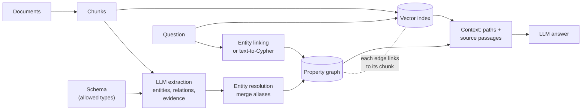
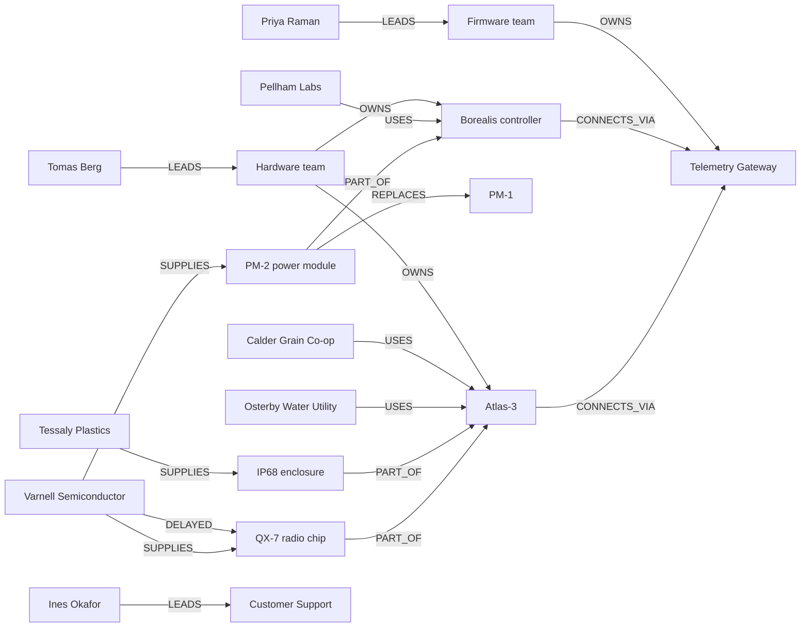

# Knowledge graphs for AI engineers: when GraphRAG beats chunk search, and when it doesn't

Most retrieval-augmented generation (RAG) systems work on chunks. They split documents into passages, embed them, and hand the model the few passages most similar to the question. That works well when the answer sits in one passage. It works badly when the answer is spread across documents that don't mention each other: "which customers are affected if this supplier's chip is late?" needs the supplier register, a product brief and the account list, and only the first of those looks anything like the question.

A knowledge graph stores the facts inside those documents as entities and the relations between them. Retrieval can then follow relations from one entity to the next, however far apart the documents that stated them. This article explains what a knowledge graph is, how teams build one from text with an LLM, how they query it, and the main patterns for using one in RAG (usually called GraphRAG). It works through a small example corpus end to end and shows, with computed results, where the graph wins, where chunk search is just as good, and where chunk search wins.

**Try it:** this folder contains a guided web app. Watch a document's entities move into a graph, see duplicate names merge, then pick a question and follow the traversal hop by hop while chunk search lists its passages, ending in a score for each method. It runs offline with no API key. See [The demo app](#the-demo-app).

## Key takeaways

1. **A knowledge graph turns sentences into connections you can follow.** "Varnell supplies the QX-7" and "Osterby runs 420 Atlas-3 units" live in different documents. In a graph they are two edges two hops apart, so a query can walk from the supplier to the customer.
2. **Building one is extraction, then resolution.** An LLM reads each chunk and returns entities and relations. Entity resolution then decides that "Varnell Semi", "Varnell" and "Varnell Semiconductor" are one node. Skip resolution and every multi-hop path through that company breaks.
3. **GraphRAG is a family of retrieval patterns, not one algorithm.** Entity-neighbourhood ("local") retrieval, multi-hop traversal, text-to-Cypher, community summaries for whole-corpus questions, and hybrids of graph and vector search all count.
4. **Graphs win on connected questions.** In our example, chunk search (top 3) found 0 of 3 facts for "which customers would a QX-7 delay affect?", and 1 of 7 for "how many customers depend on Varnell?". The graph traversal found all of them.
5. **Graphs lose on prose.** "What did the incident review recommend?" has no entity-to-entity answer, so extraction never turned it into an edge. Chunk search found it first time. The practical answer is usually hybrid: return the graph path *and* the passages it came from.
6. **The costs are real.** Every chunk needs an LLM extraction call at indexing time, extraction misses and invents relations, and the schema needs an owner. Published comparisons find that GraphRAG helps on multi-hop and summary questions and that plain RAG is as good or better on single-hop detail questions.

## What a knowledge graph is

A knowledge graph is a set of **nodes** (entities: a person, a product, a company) connected by **edges** (relations: *leads*, *supplies*, *uses*). Both can carry **properties**, key-value facts such as `units: 420` on the edge *Osterby Water Utility USES Atlas-3*. A **schema** (in the semantic-web world, an **ontology**) says which node types and relation types exist and which types each relation may connect, for example that `SUPPLIES` goes from a `Company` to a `Component`.

Written as triples, two facts from our example look like this:

```text
(Varnell Semiconductor) -[SUPPLIES]-> (QX-7 radio chip)
(Osterby Water Utility) -[USES {units: 420}]-> (Atlas-3)
```

There are two common ways to store such a graph:

| | Property graph | RDF |
| --- | --- | --- |
| Data model | Nodes and relationships, each with labels and key-value properties | Triples of subject, predicate and object, identified by IRIs ([RDF 1.1](https://www.w3.org/TR/rdf11-concepts/)) |
| Query language | Cypher (Neo4j, Memgraph and others), or ISO GQL, published in 2024 as [ISO/IEC 39075](https://webstore.iec.ch/publication/94107) | [SPARQL 1.1](https://www.w3.org/TR/sparql11-query/) |
| Properties on edges | Built in | Need extra modelling (reification or RDF-star) |
| Strengths | Simple to start with, popular in GraphRAG tooling | Global identifiers, shared vocabularies, reasoning over formal ontologies |

Most GraphRAG libraries target property graphs and Cypher, so this article does too. RDF is the better fit when you must link to public vocabularies or other organizations' data.

### Chunk RAG, graph RAG and hybrid

| | Chunk (vector) RAG | Knowledge-graph RAG | Hybrid |
| --- | --- | --- | --- |
| Index | Embedded passages | Entities and relations extracted by an LLM | Both, linked: each edge points back to the passage it came from |
| Indexing cost | One embedding per chunk | At least one LLM call per chunk, plus resolution | Both |
| Good at | Questions answered by one or two passages; wording and detail | Multi-hop questions, "how is X connected to Y", counting and listing across documents | Both kinds, at the cost of more context |
| Weak at | Facts spread over passages that don't resemble the question | Anything the extractor didn't capture: reasons, recommendations, nuance | More moving parts |
| Fails by | Returning the wrong passages | Missing or wrong edges, unmerged duplicate entities | Either, less often |

## How GraphRAG works



The survey by [Peng et al. (2024)](https://arxiv.org/abs/2408.08921) splits the workflow into graph-based indexing, graph-guided retrieval and graph-enhanced generation. In practice the steps are these.

### 1. Extraction

An LLM reads one chunk at a time and returns entities and relations, ideally as structured output that matches a JSON schema. Give it the schema: the allowed entity types, the allowed relation types, and which types each relation connects. Without one, the model invents a new relation name for every sentence (`IS_MADE_BY`, `MANUFACTURES`, `PRODUCES`) and the graph can't be queried reliably.

The libraries expose this directly. LangChain's `LLMGraphTransformer`, now in the [`langchain-neo4j` package](https://reference.langchain.com/python/langchain-neo4j/graph_transformers/llm/LLMGraphTransformer), takes `allowed_nodes`, `allowed_relationships` and `node_properties`, and with `strict_mode` (on by default) filters out anything outside them. LlamaIndex's [`PropertyGraphIndex`](https://developers.llamaindex.ai/python/framework/module_guides/indexing/lpg_index_guide/) offers `SimpleLLMPathExtractor` for free-form triples, `DynamicLLMPathExtractor` for suggested types, and `SchemaLLMPathExtractor` for a strict schema. Microsoft GraphRAG's [default pipeline](https://microsoft.github.io/graphrag/index/default_dataflow/) extracts entities (title, type, description) and relationships (source, target, description) from 1,200-token text units by default.

Ask the model for **evidence** too: the exact words that state each relation. Evidence lets you check the extraction against the text automatically, and lets retrieval return the source passage alongside the edge.

### 2. Entity resolution

Extraction runs per chunk, so the same thing arrives under different names. In our six documents, one supplier appears as "Varnell Semi", "Varnell" and "Varnell Semiconductor", and one engineer as "Tomas Berg" and "T. Berg". Resolution merges them. Common approaches, from cheapest to most expensive:

- **Exact match after normalizing** case and punctuation ("Atlas 3" = "Atlas-3"). Microsoft GraphRAG merges entities that share a title and type, then has an LLM condense their descriptions into one ([default dataflow](https://microsoft.github.io/graphrag/index/default_dataflow/)).
- **Fuzzy or abbreviation rules**: string similarity, initials, prefixes. Neo4j's `neo4j-graphrag` package ships [`SinglePropertyExactMatchResolver`, `FuzzyMatchResolver` (RapidFuzz) and `SpaCySemanticMatchResolver` (embedding similarity)](https://neo4j.com/docs/neo4j-graphrag-python/current/_modules/neo4j_graphrag/components/resolver.html).
- **Embedding similarity plus an LLM or human check** for borderline pairs, which matters when two genuinely different entities have similar names.

Always restrict merges to the same type, and never merge when a name could refer to more than one entity. A wrong merge is worse than a missed one: it connects facts that have nothing to do with each other.

### 3. Storing and querying

Load the resolved entities and relations into a graph store. A Cypher query names a pattern of nodes and relationships, and the database finds every match:

```cypher
// Which customers use a product that contains the QX-7?
MATCH (:Component {name: 'QX-7 radio chip'})-[:PART_OF]->(:Product)<-[:USES]-(c:Customer)
RETURN DISTINCT c.name
```

Variable-length patterns cover "connected somehow" questions. Current Cypher writes them as quantified relationships such as `-[:NEXT]->{1,10}`; the older `-[*1..3]-` form still works but is not GQL-conformant ([Cypher manual](https://neo4j.com/docs/cypher-manual/current/patterns/variable-length-patterns/)).

### 4. Retrieval patterns

| Pattern | How it works | Good for | Examples |
| --- | --- | --- | --- |
| **Local (entity neighbourhood)** | Find the entities the question mentions (by name or by embedding), then return their neighbours, relations and linked passages | "Tell me about X" | GraphRAG [local search](https://microsoft.github.io/graphrag/query/local_search/), LightRAG `local` mode, LlamaIndex `VectorContextRetriever` |
| **Multi-hop traversal** | Follow a fixed relation pattern, or a shortest path, from the linked entities | Supply chains, ownership, "how is X connected to Y", impact analysis | Cypher `MATCH`, HippoRAG's Personalized PageRank |
| **Text-to-Cypher** | An LLM writes the query from the schema and the question; the database runs it | Precise filters, counts and aggregations | LlamaIndex `TextToCypherRetriever`, neo4j-graphrag `Text2CypherRetriever`, LangChain `GraphCypherQAChain` |
| **Community summaries (global)** | Cluster the graph into communities (Leiden), have an LLM summarize each, then map-reduce the summaries to answer | "What are the main themes across the corpus?" | Microsoft GraphRAG [global search](https://microsoft.github.io/graphrag/query/global_search/) |
| **Hybrid vector + graph** | Vector search finds entry nodes or passages; a graph query expands from them; both go into the context | Most production systems | neo4j-graphrag `VectorCypherRetriever`, LightRAG `hybrid` and `mix` modes |

**Community summaries** solve a problem chunk retrieval can't: questions about the whole corpus. Edge et al. ([*From Local to Global*, 2024](https://arxiv.org/abs/2404.16130)) build an entity graph, precompute summaries for communities of closely related entities, answer from each summary, and merge the partial answers. On global sensemaking questions over datasets in the one-million-token range, they report substantial gains over a conventional RAG baseline in comprehensiveness and diversity. The price is many LLM calls at indexing time, and Microsoft's later [LazyGraphRAG](https://www.microsoft.com/en-us/research/blog/lazygraphrag-setting-a-new-standard-for-quality-and-cost/) post describes data indexing costs "identical to vector RAG and 0.1% of the costs of full GraphRAG", by deferring LLM use to query time.

**[LightRAG](https://arxiv.org/abs/2410.05779)** (Guo et al., 2024) combines graph structure with vector retrieval in a "dual-level" scheme that retrieves both low-level (specific entities) and high-level (broader themes) knowledge, and adds an incremental update so new documents don't force a full rebuild. Its [repository](https://github.com/HKUDS/LightRAG) exposes `local`, `global`, `hybrid`, `naive` (plain chunk RAG) and `mix` query modes.

**[HippoRAG](https://arxiv.org/abs/2405.14831)** (Gutiérrez et al., NeurIPS 2024) runs Personalized PageRank over an extracted graph, seeded from the entities in the question. On multi-hop QA it reports up to 20% better results than prior methods, and single-step retrieval comparable to or better than iterative retrieval (IRCoT) while 10 to 30 times cheaper and 6 to 13 times faster.

**Text-to-Cypher needs guardrails.** The model writes code that runs against your database. LlamaIndex's guide notes that "executing arbitrary cypher has its risks" and recommends read-only roles and sandboxes. LangChain's [`GraphCypherQAChain`](https://reference.langchain.com/python/langchain-neo4j/chains/graph_qa/cypher/GraphCypherQAChain) refuses to run until you set `allow_dangerous_requests=True`, and its documentation asks for narrowly scoped database credentials. Use a read-only user, validate the generated query, and cap the result size.

## A worked example

The example corpus is six short documents from Corvane Instruments, a fictional company that makes water-quality sensors. All names are invented, and the corpus is written for this article, so it is free to reuse. The full text is in [`data/documents.json`](data/documents.json):

| Document | What it says |
| --- | --- |
| **Engineering teams, Q3 update** | Priya Raman leads the Firmware team. The Firmware team owns the Telemetry Gateway, the cloud service that receives data from our devices. Tomas Berg leads the Hardware team, which owns the Atlas-3 and Borealis controller designs. Ines Okafor leads Customer Support. |
| **Atlas-3 sensor: product brief** | The Atlas-3 sends readings every 15 minutes through the Telemetry Gateway. Its main board uses the QX-7 radio chip. Its housing is the IP68 enclosure. |
| **Supplier register (excerpt)** | Varnell Semi is the sole supplier of the QX-7 radio chip. Tessaly Plastics supplies the IP68 enclosure. |
| **Borealis controller: release notes 2.4** | The Borealis controller now takes power from the PM-2 power module, which replaces the older PM-1. The PM-2 is made by Varnell. Firmware updates are delivered through the Telemetry Gateway. The design is maintained by T. Berg and the Hardware team. |
| **Key accounts** | Osterby Water Utility runs 420 Atlas-3 units. Calder Grain Co-op monitors silo humidity with 60 Atlas 3 units. Pellham Labs uses the Borealis controller. |
| **Incident review: QX-7 shipment delay** | On 3 March 2026, Varnell Semiconductor said QX-7 shipments would slip by six weeks. The review recommended qualifying a second radio-chip supplier by the end of Q3 and keeping eight weeks of chip stock on hand. |

(The table abridges the documents; the app and the code use the full text.)

### Extraction

The schema allows seven entity types (Person, Team, Service, Product, Component, Company, Customer) and eight relation types, defined in [`src/schema.ts`](src/schema.ts). The extraction results are committed as JSON in [`data/extractions/`](data/extractions/), one file per document, in the shape an LLM returns. **They are hand-written fixtures, not live model output**, so the example is deterministic; [`npm run extract -- --live`](#run-it) regenerates them with Gemini. The Borealis release notes, for example, produce:

```json
{
  "entities": [
    { "name": "Borealis", "type": "Product", "properties": { "version": "2.4" } },
    { "name": "Borealis controller", "type": "Product" },
    { "name": "PM-2 power module", "type": "Component" },
    { "name": "PM-1", "type": "Component" },
    { "name": "Varnell", "type": "Company" },
    { "name": "Telemetry Gateway", "type": "Service" },
    { "name": "T. Berg", "type": "Person" },
    { "name": "Hardware team", "type": "Team" }
  ],
  "relations": [
    { "source": "PM-2 power module", "type": "PART_OF", "target": "Borealis controller",
      "evidence": "The Borealis controller now takes power from the PM-2 power module" },
    { "source": "Varnell", "type": "SUPPLIES", "target": "PM-2 power module",
      "evidence": "The PM-2 power module is made by Varnell." }
  ]
}
```

(Four more relations are omitted here.) `validateExtraction()` rejects any entity or evidence string that isn't in the text and any relation that breaks the schema, such as a `SUPPLIES` edge starting at a Person.

### Resolution

Across the six documents the extractor returned 33 entity names and 21 relations. Resolution ([`src/resolve.ts`](src/resolve.ts)) merges names of the same type that are equal after normalizing, or where every word of the shorter name starts the matching word of the longer one. Numbers must match exactly, so PM-1 never merges with PM-2. Names that match more than one entity are reported, not merged. These merges are computed:

| Extracted name | Merged into | Rule |
| --- | --- | --- |
| "Varnell Semi", "Varnell" | Varnell Semiconductor | abbreviation |
| "QX-7" | QX-7 radio chip | abbreviation |
| "Borealis" | Borealis controller | abbreviation |
| "T. Berg" | Tomas Berg | initial |
| "Atlas 3" | Atlas-3 | same name after normalizing |

The result is **18 entities and 19 relations**. Two relations were stated twice (the Hardware team owning the Borealis design, and Tomas Berg leading the Hardware team, once as "T. Berg") and merged into single edges with two pieces of evidence.

### The graph



Edge properties are kept too: `USES {units: 420}`, `CONNECTS_VIA {interval: 15 minutes}`, `DELAYED {date: 2026-03-03, delay: six weeks, cause: wafer shortage}`.

### Six questions, answered both ways

Each question has a short list of facts its correct answer needs, and each fact has the sentence that states it and, where one was extracted, the edge that represents it ([`data/questions.json`](data/questions.json)). Then, in [`src/compare.ts`](src/compare.ts):

- **Chunk search** splits every document into paragraphs (17 chunks, each with its document title attached), ranks them by TF-IDF cosine similarity to the question and returns the top *k*. A fact counts as retrieved when a returned chunk contains its sentence. TF-IDF stands in for an embedding model so that the comparison runs offline and gives the same result every time.
- **Graph retrieval** runs the question's traversal: a relation pattern (what text-to-Cypher would generate), a shortest path, or an entity's neighbourhood. **The traversal for each question is scripted; running it is computed.** A fact counts as retrieved when the traversal returned its edge.
- **Hybrid** returns the graph's edges, the paragraphs those edges were extracted from, and the top *k* chunks.

These are the computed results with *k* = 3 (`npm run compare`):

| Question | Type | Chunk search | Graph | Hybrid |
| --- | --- | --- | --- | --- |
| Osterby Water Utility says its sensors stopped uploading readings. Which team and team lead should get the ticket? | Multi-hop | 2 of 4 | 4 of 4 | 4 of 4 |
| Which customers would be affected by a delay in QX-7 radio chip shipments? | Multi-hop | 0 of 3 | 3 of 3 | 3 of 3 |
| How many customers depend on parts from Varnell Semiconductor? | Aggregation | 1 of 7 | 7 of 7 | 7 of 7 |
| How is Pellham Labs connected to Varnell Semiconductor? | Connection | 1 of 3 | 3 of 3 | 3 of 3 |
| Who leads the Firmware team? | Single fact | 1 of 1 | 1 of 1 | 1 of 1 |
| What did the incident review recommend after the QX-7 shipment delay? | Detail in prose | 1 of 1 | 0 of 1 | 1 of 1 |

#### Where chunk search misses a hop

**"Which customers would be affected by a delay in QX-7 radio chip shipments?"** The correct answer is Osterby Water Utility and Calder Grain Co-op: the QX-7 is part of the Atlas-3, and both run Atlas-3 sensors.

Chunk search returned the three paragraphs of the incident review, because its title and text repeat "QX-7", "shipment" and "delay". The paragraph that says the QX-7 is part of the Atlas-3 ranked 5th of 17. The two paragraphs that name the customers ranked lower still: they share no words with the question at all, because the account list talks about Atlas-3 units, not radio chips. **No similarity measure can rank a passage highly for a question it has nothing in common with**; the link between "QX-7" and "Osterby" exists only through a third document. An embedding model would match synonyms that TF-IDF misses, but the account list still isn't about radio chips.

The graph links "QX-7" in the question to the `QX-7 radio chip` node, follows `PART_OF` to the Atlas-3, then `USES` backwards to both customers:

```text
(QX-7 radio chip) -[PART_OF]-> (Atlas-3) <-[USES {units: 420}]- (Osterby Water Utility)
                                         <-[USES {units: 60}]-  (Calder Grain Co-op)
```

**"Osterby Water Utility says its sensors stopped uploading readings. Which team and team lead should get the ticket?"** needs four hops: Osterby uses the Atlas-3, the Atlas-3 uploads through the Telemetry Gateway, the Firmware team owns the gateway, and Priya Raman leads the Firmware team. Chunk search found the first two. The org chart paragraph with the last two ranked 4th of 17, one place below the cut-off. The graph followed `USES → CONNECTS_VIA → ←OWNS → ←LEADS` and returned Priya Raman with the whole path.

**"How many customers depend on parts from Varnell Semiconductor?"** is an aggregation over two branches (QX-7 → Atlas-3 → two customers, PM-2 → Borealis → one customer). Chunk search found 1 of the 7 facts. A count over a graph pattern is one query; over chunks, it needs every relevant passage in the context and the model to do the joining.

#### Where chunk search is as good

**"Who leads the Firmware team?"** One sentence answers it. Chunk search ranked that paragraph first, and the graph returned one edge. For questions like this, the graph adds indexing cost and adds no recall.

#### Where chunk search wins

**"What did the incident review recommend after the QX-7 shipment delay?"** The answer, "qualify a second radio-chip supplier by the end of Q3 and keep eight weeks of chip stock on hand", is a recommendation, not a relation between two entities. The schema has no relation type for it, so the extractor didn't produce an edge. The graph's neighbourhood of the QX-7 contains three edges: Varnell supplies it, Varnell delayed it, and it is part of the Atlas-3. It knows *that* there was a delay, not what anyone decided to do about it. Chunk search ranked the recommendation first. Hybrid retrieval gets it because it returns passages too.

#### The budget question

A bigger *k* helps chunk search, at the cost of more context. With *k* = 5 (`npm run compare -- --k 5`), chunk search finds all 4 facts for the support-ticket question, but still only 1 of 3 for the QX-7 customers, 2 of 7 for the Varnell count and 2 of 3 for the Pellham connection. In this corpus, 5 chunks is already 29% of everything. Passages that share no words with the question don't get closer by raising *k* a little.

**What these numbers are, and aren't.** They are computed from fixed inputs on a 17-chunk corpus written to illustrate the patterns, with hand-written extraction and scripted traversals. They show the mechanism. They are not a benchmark, and they say nothing about extraction quality, which is the hardest part in practice.

## What the research says

Controlled comparisons agree with the shape of the example, and add caveats:

- Han et al., [*RAG vs. GraphRAG: A Systematic Evaluation and Key Insights*](https://arxiv.org/abs/2502.11371) (2025), compare both under one protocol. They find that RAG does well on detailed single-hop questions, while GraphRAG methods do better on multi-hop questions, and summary-level graph retrieval helps comparison and temporal questions. They also report that knowledge-graph-based GraphRAG generally underperforms on question answering because of limited graph coverage: only 65.8% of answer entities were in the HotpotQA graph and 65.5% in the NQ graph. Combining or choosing between the two approaches gave consistent gains.
- Xiang et al., [*When to use Graphs in RAG*](https://arxiv.org/abs/2506.05690) (ICLR 2026), start from the observation that GraphRAG frequently underperforms vanilla RAG on real-world tasks, and build GraphRAG-Bench to find out when graphs help. Their benchmark covers fact retrieval, complex reasoning, contextual summarization and creative generation, and evaluates graph construction, retrieval and generation separately.

## Failure modes

| Failure | What happens | Mitigation |
| --- | --- | --- |
| Missed relations | The edge for a hop was never extracted, so the path doesn't exist | Smaller chunks, a second extraction pass over the same chunk, extraction evals against a labelled sample, hybrid retrieval as a fallback |
| Invented relations | The extractor states a relation the text doesn't | Require evidence spans and check they are in the text; keep the source chunk on every edge |
| Unmerged duplicates | "Varnell Semi" and "Varnell Semiconductor" are separate nodes; paths through them break | Entity resolution with type constraints; monitor nodes with similar names |
| Wrong merges | Two different people called "A. Berg" become one; unrelated facts get connected | Never merge ambiguous names; human review for high-stakes merges |
| Schema drift | New documents need relation types the schema lacks, so they are dropped or forced into the wrong type | Give the schema an owner; log rejected extractions and review them |
| Unsafe text-to-Cypher | A generated query writes, deletes or reads more than it should | Read-only credentials, query validation, result limits |
| Stale graph | Documents change but their edges don't | Re-extract on change, keep provenance so edges from a deleted document can be removed |
| Graph-only context | The answer needs prose the graph doesn't hold | Return each edge's source passage (hybrid) |

## Practical advice

1. **Start from the questions.** Write down 20 to 50 real questions and mark which are multi-hop, aggregations or "how is X connected to Y". If almost none are, improve chunking, hybrid search and reranking first.
2. **Design a small schema.** Five to ten entity types and a dozen relation types that your questions need. Each relation should connect specific types.
3. **Extract with structured output and evidence**, then validate every result against the schema and the text, as `validateExtraction()` does here.
4. **Resolve entities conservatively**, within a type, and log what was merged and what was ambiguous.
5. **Keep provenance on every edge.** It makes answers citable, lets hybrid retrieval return the passage, and makes deletions possible.
6. **Retrieve hybrid by default**: vector search for entry points and detail, graph expansion for connections, both in the context.
7. **Prefer templates to free text-to-Cypher** for frequent question shapes (LlamaIndex's `CypherTemplateRetriever` does this), and run anything generated with read-only credentials.
8. **Evaluate both stages.** Measure extraction precision and recall on a labelled sample, and retrieval on your question set, as the fact table in this example does.

## The demo app

The app stages the example above as a short guided walkthrough: an opening and three chapters, each with a plain caption at every step.

- **Opening.** Words from the six documents appear as a page of text. The entity names darken, move to their places and settle into a graph as the relations draw in. Then you can begin with the first document, or skip straight to the questions.
- **1 Extract.** Pick a document. The entities in the text are marked one after another, then each moves into the graph as a node. When a name is an alias ("Varnell Semi"), it waits above its entity (Varnell Semiconductor) and then joins it, and the relations from the document draw in as edges.
- **2 Merge.** All 33 extracted names appear beside their entities. Identical names merge first, then each alias group joins its entity in turn, marked in the accent colour: 33 names become 18 entities, and 21 relations become 19 edges.
- **3 Ask.** Pick a question. The traversal draws itself hop by hop as a line in the accent colour, while chunk search lists its top passages in the panel (collapsed, with any matched fact underlined). At the end a score card shows each method's count of the facts the answer needs, the verdict and the correct answer. The prose-detail question plays the same way, and there chunk search wins.

The graph is drawn like a technical diagram. Each entity type has its own small shape (● person, ○ team, ◇ service, ■ product, □ component, ▲ company, ◆ customer), edges are thin grey lines, and labels are placed so they don't collide. The page is light by default, warm off-white paper with ink, plus one muted blue accent for the active path, and a charcoal dark mode is available. Drag to pan, use the buttons or Ctrl and scroll to zoom, and hover or tap a node to see its aliases, relations and source documents. The controls replay a scene, step back and forward through it, pause it, or skip to the end. One thing moves at a time, and no step lasts longer than about 1.2 seconds. With reduced motion turned on, every scene opens on its final frame.

**Scripted:** the documents, the extraction fixtures, each question's traversal and Cypher query, its correct answer, and the staging (timings, camera moves). **Computed:** the highlights, entity resolution, the graph, the traversal, the TF-IDF ranking, the hybrid set and every verdict and score. The graph's node positions are hand-placed in [`data/layout.json`](data/layout.json) for legibility; which nodes and edges exist is computed.

### Run it

Requirements: Node.js 22.12 or later. From `rag-retrieval/knowledge-graphs/`:

```sh
npm ci
npm start          # builds the app and serves it on http://127.0.0.1:4332 (PORT and HOST to change)
npm test           # resolution, traversal, retrieval, verdicts and fixture checks; offline
npm run check      # TypeScript type check
npm run compare    # prints the comparison table above (add -- --k 5 for top 5)
npm run export     # static copy in dist/ for deployment
```

Open a chapter directly with `?scene=extract`, `?scene=merge` or `?scene=ask`, plus `&doc=` (a document id, such as `borealis`) or `&q=` (a question id from `data/questions.json`, such as `qx7-customers`), `&k=5`, and `&theme=light`. `&t=` freezes a scene at that many seconds, which is useful for screenshots. For example, `http://127.0.0.1:4332/?scene=ask&q=varnell-exposure` or `http://127.0.0.1:4332/?t=3.2`.

The app makes no API calls. The fonts load from Google Fonts.

### Re-extract with Gemini (optional, paid)

[`scripts/extract.ts`](scripts/extract.ts) sends each document to Gemini's `generateContent` endpoint with the schema as structured output (`responseMimeType: application/json` and `responseJsonSchema`, the same request shape as this repository's [guardrails experiment](../../evaluations-reliability/agent-guardrails/README.md)), validates the result, and writes it to the Git-ignored `runs/extractions/`. It never overwrites the committed fixtures.

```sh
npm run extract              # dry run: prints the prompt and the number of calls; no API calls
cp .env.example .env         # then set GEMINI_API_KEY (and GEMINI_MODEL if you like)
npm run extract -- --live    # paid: 6 calls, one per document
```

A live run makes six Gemini calls, each with one short document, retried at most twice on rate limits or server errors, with a 60-second timeout. **We did not run it live for this article**, so its output has not been checked against the fixtures. Expect the model's names, relation choices and evidence spans to differ from the fixtures, and some validation problems. Comparing the two is a useful exercise.

### Layout

| Path | What it holds |
| --- | --- |
| `data/documents.json` | The six documents |
| `data/extractions/*.json` | Extraction fixtures, one per document |
| `data/questions.json` | Questions, scripted traversals and Cypher, correct answers, required facts |
| `data/layout.json` | Node positions for the drawing |
| `src/schema.ts` | Entity and relation types, the extraction JSON schema, validation |
| `src/resolve.ts` | Entity resolution |
| `src/graph.ts` | Graph building, entity linking, pattern traversal, shortest path, neighbourhood |
| `src/retrieve.ts` | Paragraph chunking and TF-IDF ranking |
| `src/compare.ts` | Runs a question all three ways and computes the verdict |
| `src/spans.ts` | Finds mentions and evidence in the text for highlighting |
| `client/` | The app (TypeScript and Tailwind CSS v4): `engine.ts` draws the graph on a canvas as a technical diagram, `scenes.ts` stages each chapter as a timeline, `timeline.ts` is the scene clock, `app.ts` is the page |
| `scripts/` | Local server, static export, comparison table, Gemini extraction |
| `tests/graph.test.ts` | Tests (Node's built-in test runner) |

## Limitations

- **Hand-written extraction.** The fixtures are cleaner than real LLM output: every relation is correct and complete. Real extraction misses relations, adds wrong ones and names things inconsistently, and that is where most GraphRAG projects spend their effort.
- **Scripted traversals.** Each question's graph query is written by hand. In production an LLM chooses the entry entities and writes the query (text-to-Cypher) or picks a template, and it can choose wrongly.
- **TF-IDF, not embeddings.** Embeddings would rank some passages differently, mainly by matching synonyms. They would not change the central point: a passage that shares no subject with the question ranks low in any similarity measure.
- **A tiny corpus.** Seventeen chunks, 18 entities. At scale, entity linking, resolution and graph noise all get harder, and so does keeping the graph current.
- **No community summaries in the app.** Global search over community summaries is explained above but not implemented, because a corpus this small has nothing to summarize.
- **Simple resolution rules.** Prefix-and-initial matching works for this corpus. Real data needs embedding similarity and review, and will still produce some wrong merges.

## What we verified and what we did not

- The tests (`npm test`), type check (`npm run check`), comparison (`npm run compare`) and export (`npm run export`) were run on 2026-10-21, and every number in [the worked example](#a-worked-example) comes from that code.
- The live Gemini extraction was **not run**; only its dry run was. The request shape matches the repository's other Gemini examples, but this script's live output is untested.
- Claims about libraries and papers were checked against the linked documentation and abstracts on 2026-10-21. Library APIs change quickly: check the current documentation before you copy a class name.

## Sources

- Edge, Trinh, Cheng et al., [From Local to Global: A Graph RAG Approach to Query-Focused Summarization](https://arxiv.org/abs/2404.16130) (2024, revised 2025).
- Microsoft GraphRAG documentation: [overview](https://microsoft.github.io/graphrag/), [default indexing dataflow](https://microsoft.github.io/graphrag/index/default_dataflow/), [local search](https://microsoft.github.io/graphrag/query/local_search/), [global search](https://microsoft.github.io/graphrag/query/global_search/).
- Microsoft Research, [LazyGraphRAG: Setting a new standard for quality and cost](https://www.microsoft.com/en-us/research/blog/lazygraphrag-setting-a-new-standard-for-quality-and-cost/) (2024).
- Guo, Xia, Yu, Ao, Huang, [LightRAG: Simple and Fast Retrieval-Augmented Generation](https://arxiv.org/abs/2410.05779) (2024), and the [LightRAG repository](https://github.com/HKUDS/LightRAG).
- Gutiérrez, Shu, Gu, Yasunaga, Su, [HippoRAG: Neurobiologically Inspired Long-Term Memory for Large Language Models](https://arxiv.org/abs/2405.14831) (NeurIPS 2024).
- Peng, Zhu, Liu et al., [Graph Retrieval-Augmented Generation: A Survey](https://arxiv.org/abs/2408.08921) (2024).
- Han, Ma, Wang et al., [RAG vs. GraphRAG: A Systematic Evaluation and Key Insights](https://arxiv.org/abs/2502.11371) (2025).
- Xiang, Wu, Zhang et al., [When to use Graphs in RAG: A Comprehensive Analysis for Graph Retrieval-Augmented Generation](https://arxiv.org/abs/2506.05690) (ICLR 2026).
- LangChain: [`LLMGraphTransformer`](https://reference.langchain.com/python/langchain-neo4j/graph_transformers/llm/LLMGraphTransformer) and [`GraphCypherQAChain`](https://reference.langchain.com/python/langchain-neo4j/chains/graph_qa/cypher/GraphCypherQAChain) in `langchain-neo4j`.
- LlamaIndex, [Using a Property Graph Index](https://developers.llamaindex.ai/python/framework/module_guides/indexing/lpg_index_guide/).
- Neo4j: [neo4j-graphrag retrievers](https://neo4j.com/docs/neo4j-graphrag-python/current/user_guide_rag.html), [entity resolvers](https://neo4j.com/docs/neo4j-graphrag-python/current/_modules/neo4j_graphrag/components/resolver.html), [Cypher variable-length patterns](https://neo4j.com/docs/cypher-manual/current/patterns/variable-length-patterns/).
- W3C, [RDF 1.1 Concepts and Abstract Syntax](https://www.w3.org/TR/rdf11-concepts/) (2014) and [SPARQL 1.1 Query Language](https://www.w3.org/TR/sparql11-query/) (2013); ISO/IEC, [39075:2024 GQL](https://webstore.iec.ch/publication/94107).

Related in this repository: [Chunking by document type](../chunking-strategies/README.md) · [Biomedical hybrid search](../biomedical-search/README.md) · [Knowledge graph from logs in the incident response agent](../../agents/incident-response-agent/README.md#memory-and-knowledge) · [RAG & Retrieval community category](https://aiengineer.help/c/rag-retrieval/6)
